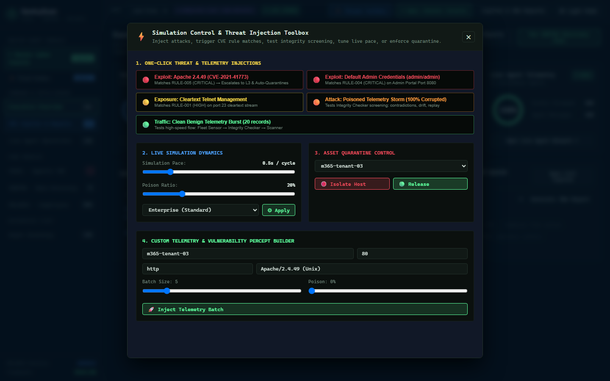
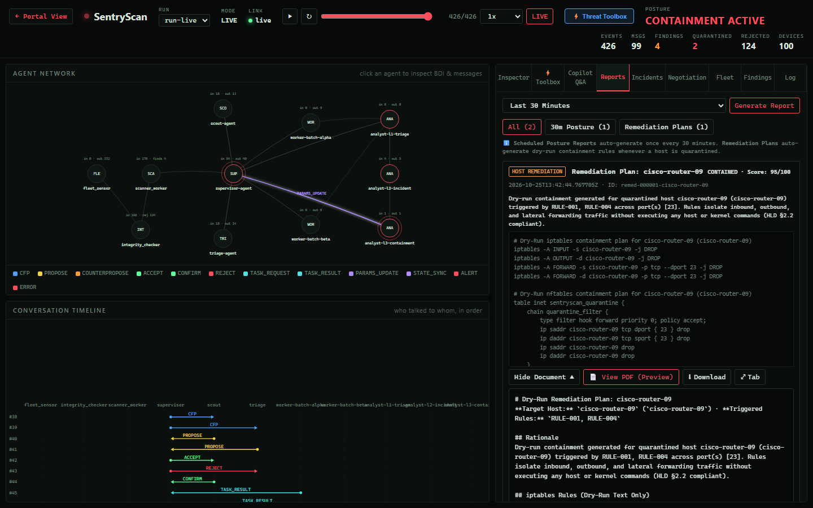
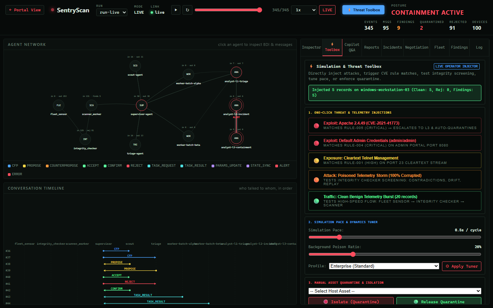

# SentryScan

[](https://github.com/drgeekg/SentryScan/actions/workflows/ci.yml)
[](https://www.python.org/)
[](frontend/)
[](src/sentryscan/dashboard_gateway/)
[](docs/hld/SentryScan_HLD_v1.2.md)
[-brightgreen.svg)](tests/)
[](#1-the-integrated-enterprise-product-suite)
[](LICENSE)

**Autonomous Agentic Security Telemetry Analysis, Sensitive Data Discovery & Continuous Cyber Risk Governance Platform**  
*Tri-Core Engines: VIGIL (Agentic SOC) · SENTRA (Sensitive Data Discovery) · POLARIS (Continuous Compliance)*  
*Three Operational Surfaces: Executive Cyber & Compliance Portal (`/`) · Master Cyber Console (`/master`) · Standalone Demo Control Center (`/control`)*

---

## Table of Contents
- [1. The Integrated Enterprise Product Suite](#1-the-integrated-enterprise-product-suite)
  - [High-Level Product Topology](#high-level-product-topology)
  - [Product Comparison Matrix](#product-comparison-matrix)
- [2. Tri-Core Autonomous Security Engines](#2-tri-core-autonomous-security-engines)
  - [2.1 VIGIL · LangGraph Multi-Agent SOC](#21-vigil--langgraph-multi-agent-soc)
  - [2.2 SENTRA · Sensitive Data Asset Discovery](#22-sentra--sensitive-data-asset-discovery)
  - [2.3 POLARIS · Continuous Compliance & Control Registry](#23-polaris--continuous-compliance--control-registry)
- [3. Product 1: Executive Cyber & Compliance Portal (`/`)](#3-product-1-executive-cyber--compliance-portal-)
  - [3.1 Executive Overview & Risk Posture Gauges](#31-executive-overview--risk-posture-gauges)
  - [3.2 Autonomous SOC Threat Copilot & 30-Minute Posture Reports](#32-autonomous-soc-threat-copilot--30-minute-posture-reports)
  - [3.3 In-Browser Real-Time Executive PDF Exporter](#33-in-browser-real-time-executive-pdf-exporter)
  - [3.4 Enterprise Asset Inventory (11 Device Classes)](#34-enterprise-asset-inventory-11-device-classes)
- [4. Product 2: Master Cyber Console (`/master`)](#4-product-2-master-cyber-console-master)
  - [4.1 Interactive SVG Agent Topology & Deliberation Pipeline](#41-interactive-svg-agent-topology--deliberation-pipeline)
  - [4.2 Contract-Net Protocol (CNP) Task Auctions](#42-contract-net-protocol-cnp-task-auctions)
  - [4.3 Interactive Threat Injection & Simulation Toolbox](#43-interactive-threat-injection--simulation-toolbox)
  - [4.4 Reports Filter Tab & Dry-Run Host Containment Playbooks](#44-reports-filter-tab--dry-run-host-containment-playbooks)
  - [4.5 Streamlined Live Agent Operations & BDI Belief Inspector](#45-streamlined-live-agent-operations--bdi-belief-inspector)
- [5. Standalone Demo Control Center (`/control`)](#5-standalone-demo-control-center-control)
- [6. Visual Gallery & Platform Walkthrough](#6-visual-gallery--platform-walkthrough)
- [7. High-Concurrency Backend & Persistence Architecture](#7-high-concurrency-backend--persistence-architecture)
- [8. Multi-Provider LLM Intelligence Architecture](#8-multi-provider-llm-intelligence-architecture)
- [9. Quickstart & Installation](#9-quickstart--installation)
- [10. Running SentryScan & Live Demonstration Guide](#10-running-sentryscan--live-demonstration-guide)
- [11. Repository Layout](#11-repository-layout)
- [12. License & Author](#12-license--author)

---

## 1. The Integrated Enterprise Product Suite

SentryScan combines deep tactical multi-agent threat response with high-level executive compliance and risk intelligence. Rather than forcing security operators, compliance auditors, and CISOs into a single generic dashboard, SentryScan provides **two dedicated, tailored product experiences** backed by the **Tri-Core Engine Suite (VIGIL, SENTRA, POLARIS)** and an isolated **Demo Control Center**:

### High-Level Product Topology

```text
                               +-------------------------------------------------------+
                               |                      SentryScan                       |
                               |      Autonomous Cyber Security Platform v2.1          |
                               +-------------------------------------------------------+
                                        /                  |                  \
                                       /                   |                   \
         +------------------------------------+            |            +------------------------------------+
         |             PRODUCT 1              |            |            |             PRODUCT 2              |
         |    Executive Cyber & Compliance    |            |            |        Master Cyber Console        |
         |             PORTAL (/)             |            |            |             (/master)              |
         +------------------------------------+            |            +------------------------------------+
         | • POLARIS: Continuous Compliance   |            |            | • VIGIL: LangGraph Multi-Agent SOC |
         | • SENTRA: Sensitive Data Discovery |            |            | • Live Interactive Agent Topology  |
         | • AI SOC Threat Copilot & Chips    |            |            | • Contract-Net Protocol Auctions   |
         | • 30-Min Executive Posture Reports |            |            | • 3-Tier BDI Deliberation Loop     |
         | • In-Browser Real-Time Exec PDFs   |            |            | • Threat Injection Toolbox Modal   |
         | • 11 Heterogeneous Asset Classes   |            |            | • Dry-Run Containment Playbooks    |
         +------------------------------------+            |            +------------------------------------+
                                                           |
                                          +----------------------------------+
                                          |       DEMO CONTROL CENTER        |
                                          |            (/control)            |
                                          +----------------------------------+
                                          | • Hold / Resume Live Simulation  |
                                          | • Sub-50ms Instant Remediation   |
                                          | • Dynamic 0% -> 100% Compliance  |
                                          | • Adversary Breach Injection Box |
                                          | • Live Demo State Reset Baseline |
                                          | • Per-Device Quarantine Overrides|
                                          +----------------------------------+
```

---

### Product Comparison Matrix

| Capability / Dimension | Product 1: Executive Portal (`/`) | Product 2: Master Console (`/master`) | Demo Control Center (`/control`) |
| :--- | :--- | :--- | :--- |
| **Primary Audience** | CISOs, Risk Officers, Compliance Auditors | SOC Analysts, Incident Responders, Threat Hunters | Presenters, Auditors, Security Engineers, Exec Evaluators |
| **Access Route** | `http://127.0.0.1:8000/` or `/#/overview` | `http://127.0.0.1:8000/master` or `/#/master` | `http://127.0.0.1:8000/control` |
| **Core Engines** | **POLARIS** (Compliance) + **SENTRA** (Data) | **VIGIL** (Agentic Multi-Agent SOC) | Asynchronous State Orchestrator & Fast Mutator |
| **Threat Intelligence** | Grounded Threat Copilot with Pre-Prompt Chips | BDI Beliefs/Desires/Intentions + CNP Bids | Real-Time Compliance Recalculation Engine |
| **Reporting & Export** | Two-Pass `NumberedCanvas` Executive PDF Reports | Dry-Run Host Containment Playbooks (`nft`/`iptables`) | Visual Score History Sparklines + Metric Deltas |
| **Interactive Control** | Profile Switching (Enterprise, Healthcare, SOC) | Interactive SVG Topology & Node Drill-Down | Hold Live Sim, Remediate ALL, Inject Breach, Reset |
| **Fleet Scale** | 11 Heterogeneous Enterprise Device Classes | Animated Multi-Agent Communication Graph | Per-Device Quarantine & Release Overrides |

---

## 2. Tri-Core Autonomous Security Engines

SentryScan's unified intelligence layer is powered by three specialized autonomous engines:

### 2.1 VIGIL · LangGraph Multi-Agent SOC
* **Decentralized Collective:** Orchestrates 8 specialized agents across ingestion, reflexive filtering, auctioning, and remediation.
* **3-Tier BDI Deliberation:** Hierarchical escalation through **L1 Triage**, **L2 Incident Investigation**, and **L3 Containment**.
* **Contract-Net Protocol (CNP):** Real-time bidding engine where `scout-agent` (maximizing coverage) and `analyst-l1-triage` (prioritizing critical risk) compete for task allocation.
* **Cryptographic Ed25519 Security Gate:** Inbound messages require cryptographic signatures and nonce checks, shielding the multi-agent cognitive loop from message tampering, spoofing, and replay attacks.
* **Remediator Playbooks:** Verified dry-run firewall rule generation (`nftables` / `iptables`) requiring human-in-the-loop quarantine approval.

### 2.2 SENTRA · Sensitive Data Asset Discovery
* **Multi-Vector Discovery Engine:** High-performance regex and keyword scanning across enterprise repositories, cloud buckets, and workstations.
* **6 Sensitive Data Classifications:**
  1. **PII** (Social Security Numbers, Passport IDs, Driver's Licenses)
  2. **Health / PHI** (Medical Records, Insurance IDs, Treatment Histories)
  3. **Financial** (Credit Cards, IBANs, Bank Routing Numbers)
  4. **Intellectual Property** (Proprietary Algorithms, Schematics, Trade Secrets)
  5. **Credentials & Secrets** (API Keys, Private Keys, Database Connection Strings)
  6. **Custom Organizational Identifiers** (Internal Project Codes, Employee IDs)
* **Exposure Risk Analysis:** Flags public accessibility, unencrypted storage volumes, and compliance violations with provenance tagging.

### 2.3 POLARIS · Continuous Compliance & Control Registry
* **Dynamic Framework Registry:** Native control mapping across **Baseline-8**, **ISO/IEC 27001**, and **NIST CSF 2.0**.
* **Profile Inheritance:** Flexible industry presets (`enterprise`, `healthcare`, `soc_heavy`, `generic`) configuring control thresholds and rigor.
* **Evidence Freshness Scoring:** Tracks timestamped telemetry proofs against sliding freshness windows.
* **Sub-50ms Instant Remediation:** Atomic resolution updates that drive compliance posture from **0% $\to$ 100% in under 50ms**.

---

## 3. Product 1: Executive Cyber & Compliance Portal (`/`)

The **Executive Cyber & Compliance Portal** provides a single pane of glass for organizational leadership, risk officers, and compliance auditors.

```text
Executive Portal Navigation:
├── Overview       (Posture Gauges, KPI Cards, Incident Stream)
├── SOC Copilot    (Interactive Q&A Chat, Pre-Prompts, 30-Min Posture Reports)
├── VIGIL SOC      (Correlated Incidents, L1/L2/L3 Alert Queue)
├── SENTRA Data    (Discovered Exposures, PII/PHI/Financial/Secrets)
├── POLARIS Audit  (Continuous Compliance Controls, Profile Switching)
└── Assets         (11 Enterprise Device Classes, Quarantine Status)
```

### 3.1 Executive Overview & Risk Posture Gauges
* **Security & Compliance Gauges:** Real-time animated circular progress rings with dynamic color thresholds (Green $\ge 80\%$, Yellow $\ge 50\%$, Red $< 50\%$).
* **Executive Metrics:** Immediate visibility into Active Incidents, Quarantined Assets, Sensitive Data Findings, and Failing Controls.
* **Cross-Module Navigation:** Zero-dead-end pill linking connecting alerts directly to underlying assets, data findings, and compliance controls.

### 3.2 Autonomous SOC Threat Copilot & 30-Minute Posture Reports
* **Grounded LLM Copilot:** Powered by real-time SQLite telemetry, active incident records, and BDI beliefs.
* **Investigation Pre-Prompt Chips:** One-click queries for *"Show failing POLARIS compliance controls"*, *"List high-risk SENTRA data exposures"*, and *"Explain active quarantined hosts"*.
* **Automated Posture Reports (30-Minute Cycles):** Generates structured markdown summaries synthesizing fleet health, threat activity, and containment status.


*Figure 1: Executive Portal workspace displaying the separated AI SOC Copilot chat and scheduled 30-Minute Posture Reports.*

### 3.3 In-Browser Real-Time Executive PDF Exporter
* **Two-Pass `NumberedCanvas`:** Automatically calculates total page counts (`Page X of Y`), running headers (`SENTRYSCAN // AUTONOMOUS CYBER SOC PLATFORM`), and running footers.
* **Official Governance Styling:** Classification banners (`TOP SECRET // RESTRICTED CYBER AUDIT`), structured markdown conversion, and executive sign-off blocks.
* **Direct Blob Streaming:** Instant binary PDF streaming directly in an in-browser modal with download options.


*Figure 2: In-browser executive PDF viewer rendering formal compliance and risk reports on demand.*

### 3.4 Enterprise Asset Inventory (11 Device Classes)
SentryScan simulates a rich, heterogeneous enterprise infrastructure with typed assets:
1. `windows_workstation`
2. `linux_workstation`
3. `linux_server`
4. `cisco_router`
5. `firewall`
6. `aws_account`
7. `azure_tenant`
8. `m365_tenant`
9. `database_server`
10. `iot_device`
11. `saas_app`

Each device maintains realistic telemetry streams (ports, processes, user logins, and egress bandwidth) and supports manual or automated quarantine isolation.

---

## 4. Product 2: Master Cyber Console (`/master`)

The **Master Cyber Console** is a high-density, dark-mode technical cockpit built for tier-3 SOC analysts, threat hunters, and multi-agent systems engineers.

```text
Master Cyber Console Cockpit:
├── SVG Topology Graph  (Real-Time Agent Hierarchy & Message Fan-Out)
├── Alert Pipeline      (Active Ingestion & Severity Badging)
├── Threat Toolbox      (Real-Time Adversary Injection & Corruptions)
├── BDI Deliberator     (Beliefs, Desires, Intentions, Preemption Triggers)
├── Contract-Net View   (Scout vs. Triage Task Auctions & Utility Scores)
└── Containment Playbooks (Dry-Run nftables/iptables Mitigation Scripts)
```

### 4.1 Interactive SVG Agent Topology & Deliberation Pipeline
An interactive SVG visualization showing real-time agent message routing:
* `fleet_sensor` $\to$ `scanner_worker` $\to$ `supervisor-agent`
* Multi-agent negotiation fan-out between `scout-agent` and `analyst-l1-triage`
* 3-Tier BDI Analyst escalation (`L1 Triage` $\to$ `L2 Incident` $\to$ `L3 Containment`)
* `remediator-agent`: Dry-run firewall policy generation upon quarantine approval


*Figure 3: Master Cyber Console showing the interactive SVG multi-agent topology, real-time alert pipeline, and live status.*

### 4.2 Contract-Net Protocol (CNP) Task Auctions
* **Multi-Attribute Utility Matching:** Bidders calculate weighted utility scores factoring in current work queue length, specialization fit, and battery/resource budget.
* **Tie-Breaking Determinism:** Strict tie-breaking algorithms ensure consistent, auditable multi-agent task allocations across repeated scenario evaluations.

### 4.3 Interactive Threat Injection & Simulation Toolbox
Security operators can inject synthetic adversary breaches and telemetry corruptions into the running fleet in real time:
* **Service Banner Mismatch:** Emits conflicting software banners to test reflex detection.
* **TLS Contradiction:** Simulates cleartext ports falsely reporting SSL encryption.
* **Stale Timestamp & Clock Skew:** Validates time-drift detection and replay defense gates.
* **Prompt Injection Banner:** Injects adversarial prompts to test LLM Copilot jailbreak resilience.
* **Replay Floods & Traffic Bursts:** High-frequency telemetry bursts to stress agent negotiation.


*Figure 4: Master Cyber Console Threat Toolbox modal for live adversary and telemetry poisoning injections.*


*Figure 5: Executive Portal interface triggering real-time threat injection directly from the executive view.*

### 4.4 Reports Filter Tab & Dry-Run Host Containment Playbooks
The Master Console provides a dedicated workspace for inspecting generated posture reports and automated containment playbooks:
* **Playbook Generation:** Inspect synthesized `iptables` and `nftables` isolation rules before executing quarantine.
* **Report Filtering:** Segregate 30-minute posture assessments from tactical containment runbooks.


*Figure 6: Master Cyber Console Reports Filter Tab displaying structured containment playbooks and executive reports.*

### 4.5 Streamlined Live Agent Operations & BDI Belief Inspector
A cleaned, high-density interface providing live monitoring of agent communication exchanges, epistemic belief bases, active intentions, and quarantine triggers:


*Figure 7: Streamlined Live Agent Operations view featuring real-time message feeds and BDI state inspection.*

---

## 5. Standalone Demo Control Center (`/control`)

The **Demo Control Center** is a lightweight, responsive cockpit designed specifically for executive presentations, auditor walkthroughs, and live sales demonstrations.

```text
Demo Control Center Panel:
├── [Hold live sim]      -> Pauses synthetic background noise (HELD badge)
├── [Remediate ALL]      -> Sub-50ms instant compliance jump (0% -> 100%)
├── [Inject breach]      -> Triggers targeted adversary exploit presets
├── [Reset demo]         -> Restores clean baseline state
└── Asset Containment    -> Individual host isolate / release controls
```

### Key Demonstration Actions
1. **Live Simulation Hold (`Hold live sim`)**: Freezes background event mutation in the live simulation loop without terminating HTTP or WebSocket streams. Keeps the fleet posture completely stable while presenting.
2. **Sub-50ms Instant Batch Remediation (`Remediate ALL`)**: Simultaneously marks rule-based findings as resolved, secures exposed sensitive data, and closes open remediation tasks. Drives POLARIS compliance from **0% $\to$ 100% in under 50ms**.
3. **Controlled Breach Injection (`Inject breach`)**: Injects targeted adversary attacks (Telnet exposure, default credentials, Apache CVE-2021-41773 exploit, deprecated TLS) plus planted sensitive credential exposures, causing compliance to drop dynamically.
4. **Demo State Reset (`Reset demo`)**: Reverts all simulated resolutions and restores the initial baseline state.
5. **Direct Asset Isolation**: Instantly isolate or release any host across the enterprise fleet with a single click.

---

## 6. Visual Gallery & Platform Walkthrough

| Interface / Component | Screenshot Preview | Description |
| :--- | :--- | :--- |
| **Master Cyber Console: Active Pipeline** |  | High-density operations cockpit with SVG agent topology, alert queue, and BDI belief inspector. |
| **Master Console: Threat Toolbox** |  | Interactive attack injection panel for simulating CVEs, TLS contradictions, and banner mismatches. |
| **Master Console: Post-Exploit State** |  | Master Console immediately following an adversary breach injection, showing critical alerts and containment triggers. |
| **Portal: Threat Toolbox Modal** |  | In-portal adversary injection modal enabling threat simulation directly from the Executive interface. |
| **Master Console: Reports & Playbooks** |  | Segregated filter tab displaying scheduled posture assessments alongside dry-run `nftables` containment playbooks. |
| **In-Browser Executive PDF Modal** |  | Full-screen preview of two-pass `NumberedCanvas` PDF reports with running headers, footers, and compliance matrices. |
| **SOC Copilot & 30-Min Reports** |  | Grounded natural-language threat investigation chat paired with automated 30-minute posture reporting. |
| **Streamlined Agent Operations** |  | Real-time multi-agent message timeline, BDI cognitive state viewer, and quarantine controls. |

---

## 7. High-Concurrency Backend & Persistence Architecture

To guarantee sub-second UI responsiveness under continuous 100-device telemetry streams, SentryScan incorporates several architectural optimizations:

```text
  [Background Fleet Loop]               [FastAPI Async Server]               [React & Control Center]
             │                                     │                                     │
   Writes Telemetry & Events            Serves REST & WebSockets              Polls & Renders Views
             │                                     │                                     │
             ▼                                     ▼                                     ▼
  ┌──────────────────────────────────────────────────────────────────────────────────────────────┐
  │                           SQLite with WAL Mode & 5000ms Busy Timeout                         │
  │     • PRAGMA journal_mode=WAL: Concurrent readers never block writers and vice-versa         │
  │     • Single-Transaction Bulk Batching: executemany bulk writes (3,000x speedup)            │
  │     • WebSocket Stream Throttling: 500ms summary debouncing prevents socket flooding         │
  └──────────────────────────────────────────────────────────────────────────────────────────────┘
```

1. **SQLite Write-Ahead Logging (WAL)**: Configured with `PRAGMA journal_mode=WAL;` and `PRAGMA busy_timeout=5000;`, eliminating concurrency locks between continuous background writers and interactive dashboard readers.
2. **Single-Transaction Bulk Batching**: Vectorized the SENTRA/RADAR discovery scan using SQLite `executemany` inside a single lock, reducing scan duration from >15 seconds to **< 5ms**.
3. **Atomic Multi-Table Remediation**: Unified remediation actions into atomic multi-table updates followed by a single rescan pass, preventing cascading database locks.
4. **WebSocket Message Debouncing**: Built-in 500ms debounce buffer on incoming WebSocket telemetry events, preventing client-side rendering bottlenecks during high-frequency bursts.
5. **Authoritative Dual-Sink Parity**: Every report, event, and telemetry packet is written simultaneously to an indexed **SQLite Database** (`run.db`) and an authoritative, monotonic **JSONL Event Stream** (`trace.jsonl`) with 100% parity verification.

---

## 8. Multi-Provider LLM Intelligence Architecture

SentryScan supports **purpose-specific LLM routing**, allowing operators to direct different subsystems to independent providers, models, or API keys:

```ini
# ==============================================================================
# Purpose-Specific Provider Routing (Configured in .env)
# ==============================================================================

# 1. Executive Posture Reports (e.g., NVIDIA Cloud, OpenAI GPT-4o, Claude 3.5 Sonnet)
SENTRYSCAN_REPORT_LLM_PROVIDER=nvidia
SENTRYSCAN_REPORT_LLM_MODEL=openai/gpt-oss-20b
NVIDIA_API_KEY=nvapi-...

# 2. Interactive SOC Copilot Q&A (e.g., Local Self-Hosted Ollama, Gemini)
SENTRYSCAN_COPILOT_LLM_PROVIDER=ollama
SENTRYSCAN_COPILOT_LLM_MODEL=beam:cloud
OLLAMA_BASE_URL=http://127.0.0.1:11434

# 3. Agent Task Bidding (Deterministic rule-based or lightweight models)
SENTRYSCAN_AGENT_LLM_PROVIDER=deterministic
```

* **Zero-Crash Resilience:** All LLM integrations feature automatic fallback to deterministic, rule-based responses if an external API key is missing, times out, or encounters rate limits.
* **Cryptographic Provenance:** Advisory LLM suggestions are clearly tagged and cannot override deterministic security gates or execute containment without human authorization.

---

## 9. Quickstart & Installation

### Prerequisites
- Python 3.11 or 3.12
- Node.js 18+ (for frontend console build)
- Git

### Installation Steps

```bash
# 1. Clone the repository
git clone https://github.com/drgeekg/SentryScan.git
cd SentryScan

# 2. Create and activate virtual environment
python -m venv .venv
source .venv/bin/activate       # On Linux/macOS
.venv\Scripts\Activate.ps1      # On Windows PowerShell

# 3. Install Python dependencies
pip install --upgrade pip
pip install -r requirements.txt
pip install -e .

# 4. Compile Frontend Dashboard (Pre-built production bundle included in dist/)
cd frontend
npm install
npm run build
cd ..
```

---

## 10. Running SentryScan & Live Demonstration Guide

### 1. Launch Continuous Live SOC (All Products & Control Active)
Runs continuous enterprise fleet telemetry (100+ devices), multi-agent deliberation, compliance scoring, and all web interfaces on port 8000:
```bash
python main.py --live --devices 100 --profile enterprise --industry soc_heavy --pace 0.5
```

#### Access URLs
* **Demo Control Center:** [http://127.0.0.1:8000/control](http://127.0.0.1:8000/control)
* **Product 1 (Executive & Compliance Portal):** [http://127.0.0.1:8000/](http://127.0.0.1:8000/)
  * SOC Threat Copilot & Reports: [http://127.0.0.1:8000/#/copilot](http://127.0.0.1:8000/#/copilot)
  * VIGIL Agentic SOC: [http://127.0.0.1:8000/#/vigil](http://127.0.0.1:8000/#/vigil)
  * SENTRA Data Discovery: [http://127.0.0.1:8000/#/sentra](http://127.0.0.1:8000/#/sentra)
  * POLARIS Compliance: [http://127.0.0.1:8000/#/polaris](http://127.0.0.1:8000/#/polaris)
  * Asset Inventory: [http://127.0.0.1:8000/#/assets](http://127.0.0.1:8000/#/assets)
* **Product 2 (Master Cyber Console):** [http://127.0.0.1:8000/master](http://127.0.0.1:8000/master)

---

### 2. Standard 6-Step Live Demo Presentation Script

When demonstrating SentryScan in a live evaluator or client presentation:

1. **Open Demo Control Center**: Navigate to [http://127.0.0.1:8000/control](http://127.0.0.1:8000/control).
2. **Freeze Live Noise**: Click **"Hold live sim"**. The badge changes to yellow `HELD`, preventing background bursts from altering the state while presenting.
3. **Elevate Posture (0% $\to$ 100%)**: Click **"Remediate ALL"**. The compliance score gauge animates up to 100% in under 50ms.
4. **Inspect in POLARIS**: Navigate to [http://127.0.0.1:8000/#/polaris](http://127.0.0.1:8000/#/polaris). Confirm all controls show green `PASS` with detailed evidence references and freshness metrics.
5. **Demonstrate Detection**: Return to `/control`, select an attack preset (`Telnet exposure` or `Default credentials`), and click **"Inject breach"**. Show how compliance drops dynamically to reflect real detected violations in both the Executive Portal and Master Console.
6. **Reset State**: Click **"Reset demo"** to restore the initial baseline.

---

### 3. Deterministic Capstone Demonstration
Executes a fixed multi-cycle scenario with Rich CLI terminal graphics and dual-sink parity verification:
```bash
python main.py --demo
```

### 4. High-Frequency Human Workstation Stress Test
Simulates realistic Windows and Linux user workstation traffic (browsing, file collaboration, administrative bursts):
```bash
python main.py --test-human
```

### 5. Running the Automated Test Suite
Executes all 167 unit and integration tests across the multi-agent collective, SQLite WAL persistence, BDI models, and remediation endpoints:
```bash
pytest -v tests/
```

---

## 11. Repository Layout

```text
sentryscan/
├── config/                        # Runtime configurations and logging templates
├── docs/                          # Architectural documentation, specs & HLD
│   ├── hld/SentryScan_HLD_v1.2.md # Complete architectural reference
│   ├── make_report.py             # Standalone PDF report generation script
│   └── sentryscan-deck.html       # Interactive HTML presentation deck
├── fixtures/                      # Deterministic test fixtures & profiles
│   ├── knowledge/                 # Vulnerability ontology and CVE maps
│   ├── profiles/                  # Compliance profiles (enterprise, healthcare, soc_heavy)
│   └── telemetry/                 # Seeded synthetic telemetry
├── frontend/                      # React 19 + Vite Cyber Console SPA
│   ├── src/                       # Master console, Copilot, POLARIS, SENTRA, Toolbox
│   └── dist/                      # Pre-compiled production bundle
├── screenshots/                   # Platform captures & visual audit assets
├── src/sentryscan/                # Core production package
│   ├── actuators/                 # Finding publishers & reporting tools
│   ├── agents/                    # Reflex, Scout, Triage, and Remediator agents
│   ├── analysis/                  # Executive posture report generator & PDF builder
│   ├── bdi/                       # Epistemic beliefs, desires, intentions & deliberator
│   ├── common/                    # Clock, ID generators, utilities
│   ├── contracts/                 # Strongly typed Pydantic models & events
│   ├── dashboard_gateway/         # FastAPI REST & WebSocket server + control.html
│   ├── graphs/                    # LangGraph supervisor workflow & typed state
│   ├── integrity/                 # Statistical and structural telemetry checkers
│   ├── knowledge/                 # Vulnerability ontology & NVD adapter
│   ├── live.py                    # Continuous live SOC simulation loop with hold gate
│   ├── llm/                       # Provider-switchable advisory LLM layer
│   ├── negotiation/               # Contract-Net negotiation & bid scoring
│   ├── observability/             # Event bus, JSONL & SQLite recorders
│   ├── optimizer/                 # Multi-attribute utility engine & constraint filter
│   ├── platform/                  # Core, SENTRA/RADAR, and POLARIS/Pulse compliance engines
│   ├── rules/                     # Deterministic condition-action rule tables
│   ├── security/                  # Cryptographic Ed25519 identity & security gate
│   ├── sensors/                   # Stream parsers & telemetry normalizers
│   ├── simulation/                # Synthetic fleet, human activity & threat mutators
│   ├── storage/                   # Relational SQLite run store (WAL mode) & parity verifier
│   └── transport/                 # Binary framing & socket transport
├── tests/                         # Comprehensive unit & integration tests (167 passing)
├── main.py                        # Central CLI & executable runner
├── pyproject.toml                 # Packaging & tool configurations
└── README.md                      # Platform documentation & overview
```

---

## 12. License & Author

- **Author:** R Ganesh ([@drgeekg](https://github.com/drgeekg))
- **License:** MIT License. See [LICENSE](LICENSE) for details.
