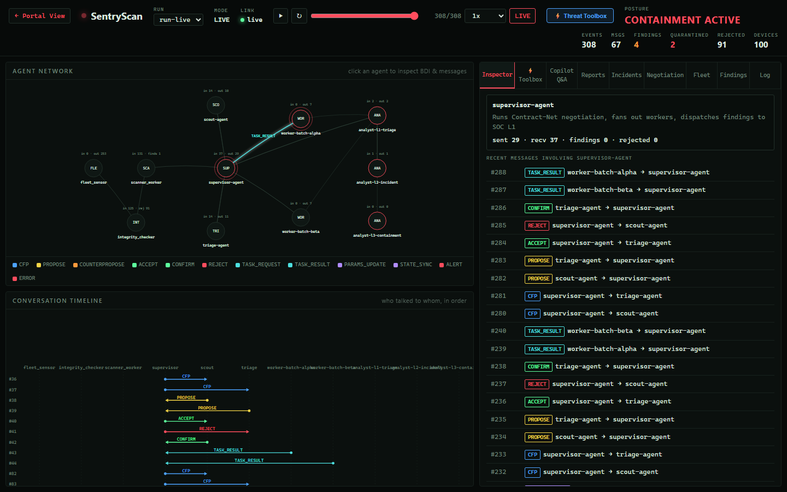
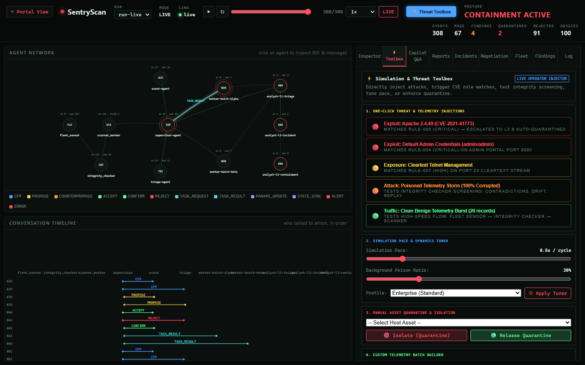
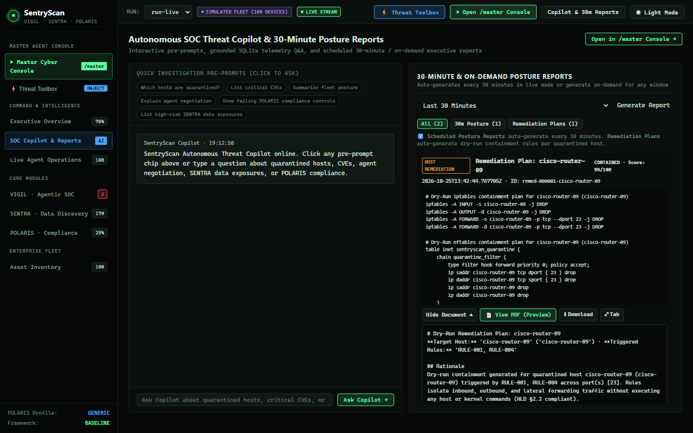
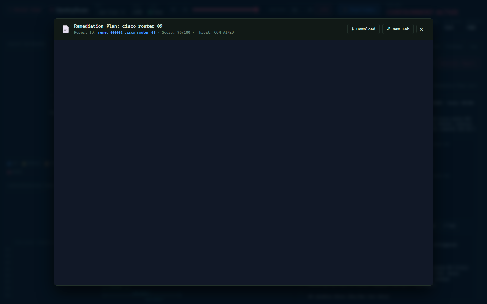
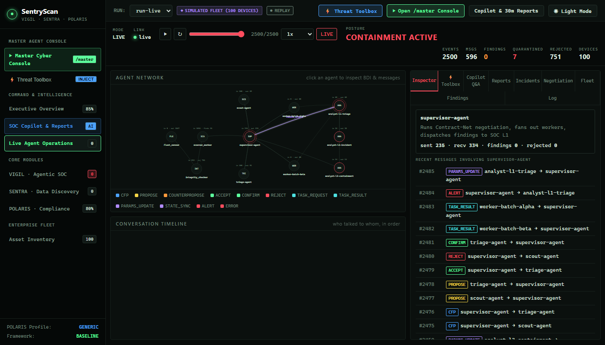

# SentryScan

[](https://github.com/drgeekg/SentryScan/actions/workflows/ci.yml)
[](https://www.python.org/)
[](LICENSE)
[](docs/hld/SentryScan_HLD_v1.2.md)
[](#determinism-contract)

**Autonomous Agentic Security Telemetry Analysis & Cyber Risk Intelligence Platform**  
*Continuous Multi-Agent Coordination, Data Discovery, Compliance Posture, and Grounded Threat Copilot.*

---

## 1. Overview & Purpose

Modern enterprise networks generate vast amounts of operational security telemetry—service banners, TLS configurations, listening ports, device announcements, and sensitive data access patterns. Security Operations Centers (SOCs) face two critical hurdles:
1. **Severe Alert Fatigue:** High volumes of uncorrelated, noisy alerts obscure critical vulnerabilities.
2. **Operational Fragility of Active Probing:** Intrusive port scanning, packet fuzzing, and live exploit checks can disrupt fragile production services, trigger network locks, or violate compliance policies.

**SentryScan** solves this by providing a **non-intrusive, autonomous agentic platform** for continuous security posture evaluation. Instead of probing live network targets, SentryScan continuously ingests, normalizes, and analyzes streaming endpoint telemetry. It identifies authentic vulnerabilities through deterministic rule tables, detects telemetry tampering via statistical and structural integrity checks, and orchestrates an autonomous agent collective to prioritize, contain, and remediate high-risk threats.

---

## 2. Platform Architecture: The Three Core Pillars

SentryScan organizes autonomous defense into three synchronized, enterprise-grade modules:

| Module | Codename | Primary Mission | Key Capabilities |
| :--- | :--- | :--- | :--- |
| **Agentic SOC** | **VIGIL** | Autonomous threat detection, triage & rapid containment | • LangGraph Multi-Agent Supervisor (`ScoutAgent`, `TriageAgent`, `RemediatorAgent`)<br>• Contract-Net negotiation & bid optimization<br>• Multi-stage BDI deliberation (Beliefs, Desires, Intentions)<br>• Automated dry-run iptables / nftables host containment playbooks |
| **Data Discovery** | **SENTRA** | Sensitive data asset discovery & exposure classification | • Real-time detection across PII, Financial, Health/PHI, Credentials & IP<br>• Public vs. Private source exposure classification<br>• Asset criticality scoring & sensitive data mapping |
| **Compliance & Posture** | **POLARIS** | Continuous automated compliance & governance controls | • Continuous controls evaluation across Baseline, ISO 27001, and NIST CSF<br>• Dynamic profile inheritance (`enterprise`, `healthcare`, `soc_heavy`, `generic`)<br>• Evidence freshness monitoring & audit-ready traceability |

---

## 3. Platform Visual Interface & Capabilities

### Master Cyber Console & Multi-Agent Network Topology
Interactive visual command center rendering real-time BDI state transitions, Contract-Net negotiation bids, live agent network topology, and event timelines.



---

### Interactive Threat Injection & Simulation Toolbox
Live operator simulation toolbox allowing real-time parameter tuning, speed modulation, and controlled adversary mutators (Service Banner Mismatch, TLS Claim Contradiction, Stale Timestamp, Prompt Injection, Replay Floods, and Traffic Bursts).



---

### Autonomous SOC Threat Copilot & Executive 30-Minute Reports
Grounded in real-time SQLite telemetry, quarantine states, and BDI beliefs. Features one-click pre-prompts, purpose-specific LLM provider routing, and segmented filtering between scheduled 30-minute posture assessments and automated host containment plans.



---

### Real-Time In-Browser Executive PDF Generation
On-demand and scheduled PDF reporting with two-pass running headers, running footers (`Page X of Y`), official classification banners, and structured markdown data tables.



---

### Live Agent Operations View
Streamlined viewport visualizing live agent interactions, peer-to-peer message exchanges, and containment rule execution without visual clutter.



---

## 4. Multi-Provider LLM Intelligence Architecture

SentryScan supports **purpose-specific LLM routing**, allowing operators to direct different subsystems to independent providers, models, or API keys:

```ini
# ==============================================================================
# Purpose-Specific Provider Routing (Optional Overrides in .env)
# ==============================================================================

# 1. Executive Posture Reports (e.g. OpenAI GPT-4o or NVIDIA NIM Cloud)
SENTRYSCAN_REPORT_LLM_PROVIDER=nvidia
SENTRYSCAN_REPORT_LLM_MODEL=openai/gpt-oss-20b
NVIDIA_API_KEY=nvapi-...

# 2. Interactive SOC Copilot Q&A (e.g. Local Self-Hosted Ollama)
SENTRYSCAN_COPILOT_LLM_PROVIDER=ollama
SENTRYSCAN_COPILOT_LLM_MODEL=beam:cloud
OLLAMA_BASE_URL=http://127.0.0.1:11434

# 3. Agent Task Bidding (Deterministic fallback or lightweight models)
SENTRYSCAN_AGENT_LLM_PROVIDER=deterministic
```

* **Zero-Crash Resilience:** All LLM integrations feature automatic fallback to deterministic, rule-based responses if an external API key is missing, times out, or encounters rate limits.
* **Dual Persistent Sinks:** Every report, message, event, and telemetry packet is written simultaneously to an indexed **SQLite Database** (`run.db`) and an authoritative, monotonic **JSONL Event Stream** (`trace.jsonl`).

---

## 5. Quickstart & Installation

### Prerequisites
- Python 3.11 or 3.12
- Node.js 18+ (for frontend dashboard)
- Git

### Installation
```bash
# Clone the repository
git clone https://github.com/drgeekg/SentryScan.git
cd SentryScan

# Create and activate virtual environment
python -m venv .venv
source .venv/bin/activate       # On Linux/macOS
.venv\Scripts\Activate.ps1      # On Windows PowerShell

# Install Python package and dependencies
pip install --upgrade pip
pip install -r requirements.txt
pip install -e .

# Install and build frontend console
cd frontend
npm install
npm run build
cd ..
```

---

## 6. Running SentryScan

### 1. Launch Continuous Live SOC Simulation (Recommended)
Runs continuous enterprise fleet telemetry, agent deliberation, compliance scoring, and the live web console:
```bash
python main.py --live --devices 100 --profile enterprise --pace 0.5
```
* **Master Cyber Console:** [http://127.0.0.1:8000/master](http://127.0.0.1:8000/master)
* **SOC Copilot & Reports:** [http://127.0.0.1:8000/#/copilot](http://127.0.0.1:8000/#/copilot)
* **Live Agent Operations:** [http://127.0.0.1:8000/#/agents](http://127.0.0.1:8000/#/agents)

### 2. Deterministic Capstone Demonstration
Executes a fixed multi-cycle scenario with Rich CLI terminal graphics and verification:
```bash
python main.py --demo
```

### 3. High-Frequency Human Workstation Test
Simulates realistic Windows/Linux user activity (browsing, file collaboration, admin tasks):
```bash
python main.py --test-human
```

### 4. Running the Test Suite
```bash
pytest -v tests/
```

---

## 7. Repository Layout

```text
sentryscan/
├── config/                        # Runtime configurations and templates
├── docs/                          # Architectural documentation & HLD
│   └── hld/SentryScan_HLD_v1.2.md # Complete architectural reference
├── fixtures/                      # Deterministic test fixtures & profiles
│   ├── knowledge/                 # Vulnerability ontology and CVE maps
│   ├── profiles/                  # Compliance profiles (enterprise, healthcare, generic)
│   └── telemetry/                 # Seeded synthetic telemetry
├── frontend/                      # React + Vite Cyber Console SPA
│   ├── src/                       # Master console, Copilot, Toolbox & Views
│   └── dist/                      # Pre-compiled production bundle
├── screenshots/                   # Platform captures & visual audit assets
├── src/sentryscan/                # Production package
│   ├── actuators/                 # Finding publishers & reporting tools
│   ├── agents/                    # Reflex, Scout, Triage, and Remediator agents
│   ├── analysis/                  # Executive posture report generator & PDF builder
│   ├── bdi/                       # Epistemic beliefs, desires, intentions & deliberator
│   ├── common/                    # Clock, ID generators, utilities
│   ├── contracts/                 # Strongly typed Pydantic models & events
│   ├── dashboard_gateway/         # FastAPI REST & WebSocket server
│   ├── graphs/                    # LangGraph supervisor workflow & typed state
│   ├── integrity/                 # Statistical and structural telemetry checkers
│   ├── knowledge/                 # Vulnerability ontology & NVD adapter
│   ├── live.py                    # Continuous live SOC simulation loop
│   ├── llm/                       # Provider-switchable advisory LLM layer
│   ├── negotiation/               # Contract-Net negotiation & bid scoring
│   ├── observability/             # Event bus, JSONL & SQLite recorders
│   ├── optimizer/                 # Multi-attribute utility engine & constraint filter
│   ├── platform/                  # Core, RADAR, and Pulse compliance engines
│   ├── rules/                     # Deterministic condition-action rule tables
│   ├── security/                  # Cryptographic Ed25519 identity & security gate
│   ├── sensors/                   # Stream parsers & telemetry normalizers
│   ├── simulation/                # Synthetic fleet, human activity & threat mutators
│   ├── storage/                   # Relational SQLite run store & parity verifier
│   └── transport/                 # Binary framing & socket transport
├── tests/                         # Comprehensive unit & integration tests
├── main.py                        # Central CLI & executable runner
├── pyproject.toml                 # Packaging & tool configurations
└── README.md                      # Platform documentation & overview
```

---

## 8. License & Credits

- **Author:** R Ganesh ([@drgeekg](https://github.com/drgeekg))
- **License:** MIT License. See [LICENSE](LICENSE) for details.
