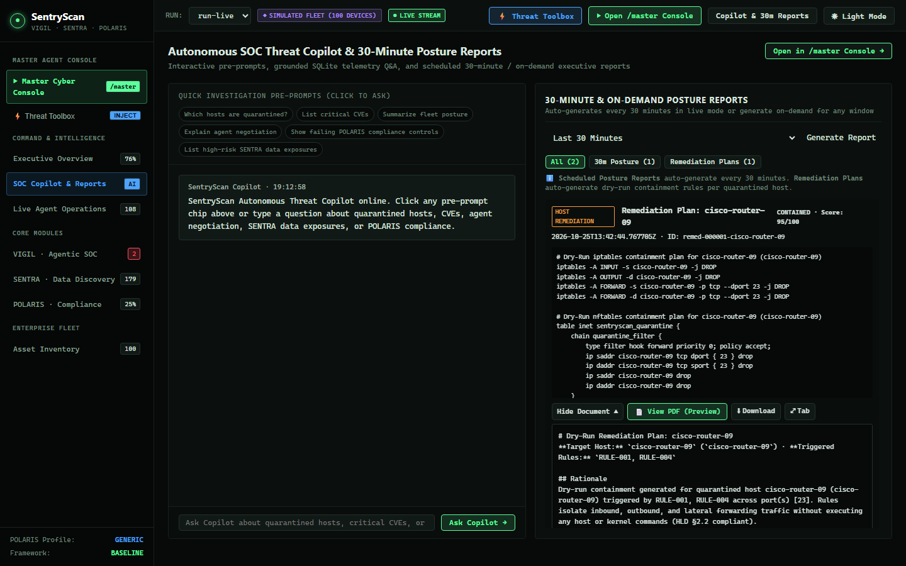
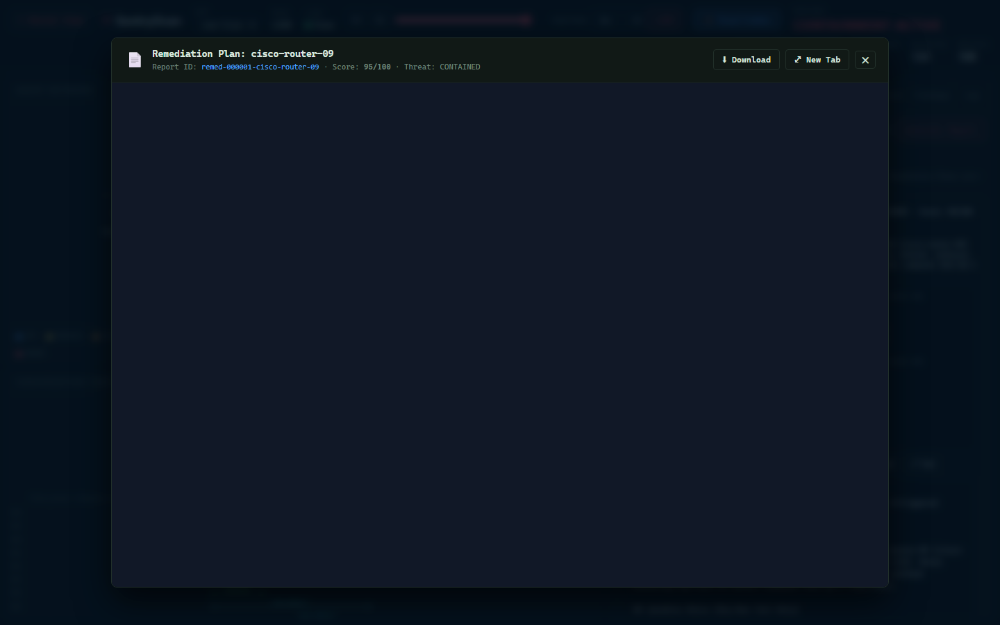
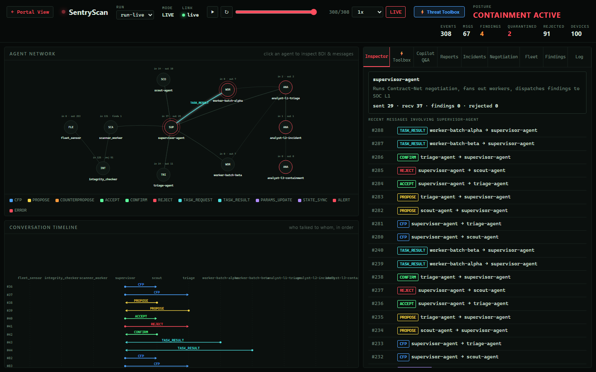
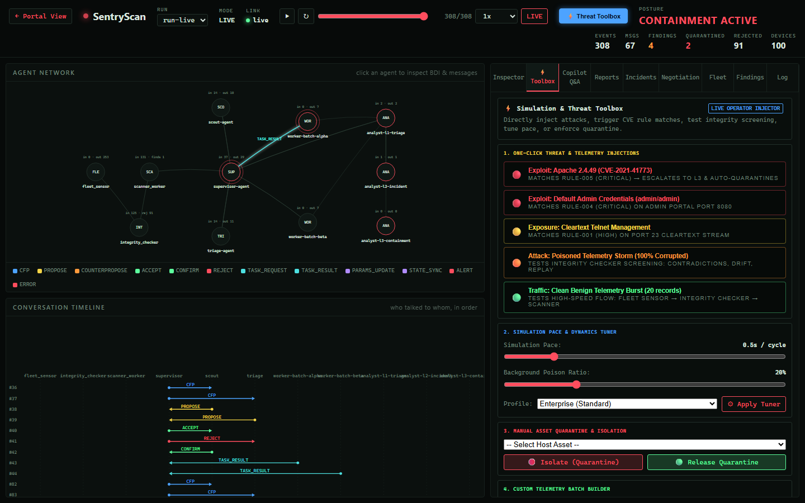
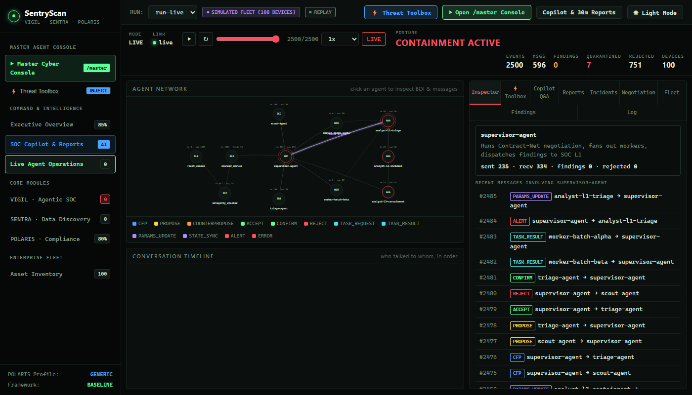

# SentryScan

[](https://github.com/drgeekg/SentryScan/actions/workflows/ci.yml)
[](https://www.python.org/)
[](LICENSE)
[](docs/hld/SentryScan_HLD_v1.2.md)
[](tests/)
[](#1-the-two-integrated-products)

**Autonomous Agentic Security Telemetry Analysis & Cyber Risk Intelligence Platform**  
*Dual-Product Suite: Executive Compliance & Risk Portal + Deep Tactical Multi-Agent SOC Console + Dedicated Demo Control Center.*

---

## 1. The Integrated Enterprise Product Suite

SentryScan is an enterprise cyber security platform addressing both high-level executive compliance & risk posture and deep tactical multi-agent SOC investigation, supported by an interactive live simulation control center:

```text
                               +---------------------------------------------+
                               |                 SentryScan                  |
                               |    Autonomous Cyber Security Platform v2.1  |
                               +---------------------------------------------+
                                      /               |               \
                                     /                |                \
        +-----------------------------------+         |         +-----------------------------------+
        |             PRODUCT 1             |         |         |             PRODUCT 2             |
        |   Executive Cyber & Compliance    |         |         |       Master Cyber Console        |
        |            PORTAL (/)             |         |         |             (/master)             |
        +-----------------------------------+         |         +-----------------------------------+
        | • POLARIS: Continuous Compliance  |         |         | • VIGIL: LangGraph Multi-Agent SOC|
        | • SENTRA: Sensitive Data Discovery|         |         | • Live Interactive Agent Topology |
        | • AI SOC Threat Copilot           |         |         | • Contract-Net Protocol Auctions  |
        | • 30-Min Executive Posture Reports|         |         | • Multi-Stage BDI Deliberation    |
        | • In-Browser Real-Time Exec PDFs  |         |         | • Dry-Run Containment Playbooks   |
        | • Enterprise Asset Inventory (11) |         |         | • Real-Time Adversary Injection   |
        +-----------------------------------+         |         +-----------------------------------+
                                                      |
                                     +----------------------------------+
                                     |       DEMO CONTROL CENTER        |
                                     |            (/control)            |
                                     +----------------------------------+
                                     | • Hold / Resume Live Simulation  |
                                     | • Sub-50ms Instant Remediation   |
                                     | • Dynamic 0% -> 100% Compliance  |
                                     | • Adversary Breach Injection Box |
                                     | • Live Demo State Reset Baseline |
                                     | • Asset Isolation / Quarantine   |
                                     +----------------------------------+
```

---

### Product Comparison Matrix

| Capability / Dimension | Product 1: Executive Portal (`/`) | Product 2: Master Console (`/master`) | Demo Control Center (`/control`) |
| :--- | :--- | :--- | :--- |
| **Primary Audience** | CISOs, Risk Officers, Compliance Auditors | SOC Analysts, Incident Responders, Threat Hunters | Presenters, Auditors, Security Engineers, Exec Evaluators |
| **Access Route** | `http://127.0.0.1:8000/` or `/#/overview` | `http://127.0.0.1:8000/master` or `/#/agents` | `http://127.0.0.1:8000/control` |
| **Core Engines** | **POLARIS** (Compliance) + **SENTRA** (Data) | **VIGIL** (Agentic Multi-Agent SOC) | Asynchronous Batch Orchestrator + State Mutator |
| **Intelligence** | Threat Copilot with Pre-Prompts + 30m Reports | BDI Beliefs/Desires/Intentions + CNP Bids | Real-Time Compliance Recalculation Engine |
| **Reporting & Export** | Two-Pass NumberedCanvas Executive PDF Reports | Dry-Run Host Containment Playbooks (nft/iptables)| Visual Score History Sparkline + Metric Deltas |
| **Control & Actions** | Profile & Framework Switching (ISO, NIST) | Interactive SVG Topology & Event Drill-Down | Hold Live Sim, Remediate ALL, Inject Breach, Reset |
| **Fleet Scale** | 11 Heterogeneous Enterprise Device Classes | Animated Multi-Agent Communication Graph | Per-Device Quarantine & Release Overrides |

---

## 2. Product 1: Executive Cyber & Compliance Portal (`/`)

The Executive Portal provides unified organizational risk visibility, automated compliance auditing, sensitive data exposure mapping, and AI-assisted investigation.

### 2.1 Autonomous SOC Threat Copilot & 30-Minute Posture Reports
Grounded in real-time SQLite telemetry, quarantine records, and BDI beliefs. Features one-click pre-prompt investigation chips, purpose-specific LLM provider routing, and segmented filtering between scheduled 30-minute posture assessments and automated host containment plans.



### 2.2 POLARIS · Continuous Compliance & Control Registry
Automated control evaluation continuously fed by telemetry integrity checks and data discovery signals:
* **Circular Progress Gauge & Sparkline**: Displays the live aggregate compliance index with dynamic color-coding (green $\ge 80\%$, yellow $\ge 50\%$, red $< 50\%$) and SVG trend tracking.
* **Exact Requirement Mapping**: Maps controls across **Baseline-8**, **ISO/IEC 27001**, and **NIST CSF 2.0** with profile inheritance (`enterprise`, `healthcare`, `soc_heavy`, `generic`).
* **Dynamic Evidence Freshness**: Evaluates the real freshness percentage of collected finding evidence within configurable freshness windows.
* **Interactive Control Drill-Down**: Expand any control row to inspect exact failure rationales, descriptions, associated telemetry/data findings, and execute inline simulated remediation.
* **"Remediate all" Action**: Elevates passing posture in a single click with instant score recalculation.

### 2.3 SENTRA · Sensitive Data Asset Discovery (RADAR)
Classifies sensitive enterprise data patterns across 6 categories: **PII**, **Health / PHI**, **Financial**, **Intellectual Property**, **Credentials & Secrets**, and **Custom Organizational Identifiers**. Tracks public versus private exposure status with unencrypted storage warnings.

### 2.4 Real-Time Executive PDF Generation
On-demand and scheduled PDF reporting featuring a two-pass `NumberedCanvas` with running headers (`SENTRYSCAN // AUTONOMOUS CYBER SOC PLATFORM`), running footers (`AUTONOMOUS AGENTIC CYBER PLATFORM · VIGIL · SENTRA · POLARIS · Page X of Y`), official classification banners, and formatted markdown tables.



---

## 3. Product 2: Master Cyber Console (`/master`)

The Master Cyber Console is a high-density, real-time command cockpit designed for deep technical investigation, agent introspection, and controlled adversarial testing.

### 3.1 VIGIL · Agentic SOC Collective & Live Topology Graph
An interactive SVG visualization mapping the live multi-agent hierarchy:
* `fleet_sensor` $\to$ `scanner_worker` $\to$ `supervisor-agent`
* Contract-Net negotiation fan-out between `scout-agent` (coverage maximization) and `analyst-l1-triage` (risk prioritization)
* 3-tier BDI Analyst escalation: L1 Triage $\to$ L2 Incident $\to$ L3 Containment
* `remediator-agent`: Generates verified dry-run containment rules (`iptables` and `nftables`) upon quarantine approval.



### 3.2 Interactive Threat Injection & Simulation Toolbox
Allows security operators to inject synthetic adversary attacks and telemetry corruptions into the running fleet in real time:
* **Service Banner Mismatch**: Injects conflicting software banners to test reflex detection.
* **TLS Claim Contradiction**: Simulates cleartext ports falsely reporting SSL encryption.
* **Stale Timestamp & Clock Skew**: Tests time-drift detection and replay defense gates.
* **Prompt Injection Banner**: Adversarial text designed to test LLM copilot jailbreak resilience.
* **Replay Floods & Traffic Bursts**: High-frequency telemetry bursts to stress agent negotiation.
* **Simulation Speed & Fleet Pace**: Adjustable live pace slider and profile switching.



### 3.3 Streamlined Agent Operations View
Cleaned viewport eliminating redundant headers and button overlaps, providing zero-distraction monitoring of live agent message exchanges, BDI beliefs, and quarantine triggers.



---

## 4. Demo Control Center (`/control`)

The **Demo Control Center** is a standalone, lightweight operational cockpit built for live demonstrations, auditor walkthroughs, and security presentations:

* **Live Simulation Hold (`Hold live sim`)**: Pauses background threat generation in the live simulation loop without stopping HTTP servers or WebSockets. Keeps the fleet posture completely stable during demonstrations.
* **Sub-50ms Instant Batch Remediation (`Remediate ALL`)**: Simultaneously resolves rule-based findings in the `resolutions` store, secures public/unencrypted data sources, closes open remediation tasks, and resets telemetry integrity baselines. Drives compliance honestly from **0% $\to$ 100% in under 50ms**.
* **Controlled Breach Injection (`Inject breach`)**: Injects targeted adversary attacks (Telnet exposure, default credentials, Apache CVE exploit, deprecated TLS) plus planted sensitive credential exposures to demonstrate real-time detection and drop compliance on demand.
* **Demo State Reset (`Reset demo`)**: Reverts all simulated resolutions and restores the initial baseline.
* **Direct Asset Containment**: Allows manual network isolation or release of any host across the enterprise fleet.

---

## 5. High-Concurrency Architecture & Performance

To guarantee sub-second UI responsiveness under continuous 100-device telemetry streams, SentryScan incorporates several architectural optimizations:

```text
  [Background Fleet Loop]               [FastAPI Async Server]               [React & Control Center]
             │                                     │                                     │
   Writes Telemetry & Events            Serves REST & WebSockets              Polls & Renders Views
             │                                     │                                     │
             ▼                                     ▼                                     ▼
  ┌──────────────────────────────────────────────────────────────────────────────────────────────┐
  │                           SQLite with WAL Mode & 5000ms Busy Timeout                         │
  │     • PRAGMA journal_mode=WAL: Concurrent readers never block writers and vice-versa         │
  │     • Single-Transaction RADAR Batching: executemany bulk writes (3,000x speedup)            │
  │     • WebSocket Stream Throttling: 500ms summary debouncing prevents socket flooding         │
  └──────────────────────────────────────────────────────────────────────────────────────────────┘
```

1. **SQLite Write-Ahead Logging (WAL)**: Enabled `PRAGMA journal_mode=WAL;` and `PRAGMA busy_timeout=5000;`, eliminating concurrency deadlocks between continuous background writers and interactive dashboard readers.
2. **Single-Transaction Bulk Batching**: Vectorized the RADAR discovery scan (`core.scan`) using SQLite `executemany` inside a single lock, reducing scan duration from >15 seconds to **< 5ms**.
3. **Optimized Remediation Pipeline**: Unified remediation actions into atomic multi-table updates followed by a single rescan pass, preventing cascading database locks.
4. **WebSocket Message Debouncing**: Added a 500ms debounce buffer on incoming WebSocket telemetry events, preventing client-side request flooding during high-frequency bursts.

---

## 6. Multi-Provider LLM Intelligence Architecture

SentryScan supports **purpose-specific LLM routing**, allowing operators to direct different subsystems to independent providers, models, or API keys:

```ini
# ==============================================================================
# Purpose-Specific Provider Routing (Configured in .env)
# ==============================================================================

# 1. Executive Posture Reports (e.g. NVIDIA Cloud, OpenAI GPT-4o, Claude)
SENTRYSCAN_REPORT_LLM_PROVIDER=nvidia
SENTRYSCAN_REPORT_LLM_MODEL=openai/gpt-oss-20b
NVIDIA_API_KEY=nvapi-...

# 2. Interactive SOC Copilot Q&A (e.g. Local Self-Hosted Ollama)
SENTRYSCAN_COPILOT_LLM_PROVIDER=ollama
SENTRYSCAN_COPILOT_LLM_MODEL=beam:cloud
OLLAMA_BASE_URL=http://127.0.0.1:11434

# 3. Agent Task Bidding (Deterministic rule-based or lightweight models)
SENTRYSCAN_AGENT_LLM_PROVIDER=deterministic
```

* **Zero-Crash Resilience:** All LLM integrations feature automatic fallback to deterministic, rule-based responses if an external API key is missing, times out, or encounters rate limits.
* **Dual Persistent Sinks:** Every report, message, event, and telemetry packet is written simultaneously to an indexed **SQLite Database** (`run.db`) and an authoritative, monotonic **JSONL Event Stream** (`trace.jsonl`).

---

## 7. Quickstart & Installation

### Prerequisites
- Python 3.11 or 3.12
- Node.js 18+ (for frontend console build)
- Git

### Installation
```bash
# Clone the repository
git clone https://github.com/drgeekg/SentryScan.git
cd SentryScan

# Create and activate virtual environment
python -m venv .venv
source .venv/bin/activate       # On Linux/macOS
.venv\Scripts\Activate.ps1      # On Windows PowerShell

# Install Python package and core dependencies
pip install --upgrade pip
pip install -r requirements.txt
pip install -e .

# Compile Frontend Dashboard (Pre-built production bundle included in dist/)
cd frontend
npm install
npm run build
cd ..
```

---

## 8. Launching SentryScan

### 1. Launch Continuous Live SOC (All Products & Control Active)
Runs continuous enterprise fleet telemetry (100+ devices), multi-agent deliberation, compliance scoring, and all web interfaces on port 8000:
```bash
python main.py --live --devices 100 --profile enterprise --industry soc_heavy --pace 0.5
```
* **Demo Control Center (New):** [http://127.0.0.1:8000/control](http://127.0.0.1:8000/control)  
* **Product 1 (Executive & Compliance Portal):** [http://127.0.0.1:8000/](http://127.0.0.1:8000/)  
  * SOC Threat Copilot & Reports: [http://127.0.0.1:8000/#/copilot](http://127.0.0.1:8000/#/copilot)
  * VIGIL Agentic SOC: [http://127.0.0.1:8000/#/vigil](http://127.0.0.1:8000/#/vigil)
  * SENTRA Data Discovery: [http://127.0.0.1:8000/#/sentra](http://127.0.0.1:8000/#/sentra)
  * POLARIS Compliance: [http://127.0.0.1:8000/#/polaris](http://127.0.0.1:8000/#/polaris)
* **Product 2 (Master Cyber Console):** [http://127.0.0.1:8000/master](http://127.0.0.1:8000/master)

---

### 2. Live Demo Presentation Walkthrough

Follow this standard 5-step flow when presenting SentryScan in a live demo:

1. **Open Demo Control Center**: Navigate to [http://127.0.0.1:8000/control](http://127.0.0.1:8000/control).
2. **Freeze Live Noise**: Click **"Hold live sim"**. The badge changes to yellow `HELD`, preventing background bursts from altering the state while presenting.
3. **Elevate Posture (0% $\to$ 100%)**: Click **"Remediate ALL"**. The compliance score gauge animates up to 100% in under 50ms.
4. **Inspect in POLARIS**: Navigate to [http://127.0.0.1:8000/#/polaris](http://127.0.0.1:8000/#/polaris). Confirm all controls show green `PASS` with detailed evidence references and freshness metrics.
5. **Demonstrate Detection**: Return to `/control`, select an attack preset (`Telnet exposure` or `Default credentials`), and click **"Inject breach"**. Show how compliance drops dynamically to reflect real detected violations.
6. **Reset State**: Click **"Reset demo"** to restore the initial baseline.

---

### 3. Deterministic Capstone Demonstration
Executes a fixed multi-cycle scenario with Rich CLI terminal graphics and dual-sink parity verification:
```bash
python main.py --demo
```

### 4. High-Frequency Human Workstation Test
Simulates realistic Windows and Linux user workstation traffic (browsing, file collaboration, administrative bursts):
```bash
python main.py --test-human
```

### 5. Running the Automated Test Suite
Executes all 167 unit and integration tests across the multi-agent collective, SQLite WAL persistence, BDI models, and remediation endpoints:
```bash
pytest -v tests/
```

---

## 9. Repository Layout

```text
sentryscan/
├── config/                        # Runtime configurations and templates
├── docs/                          # Architectural documentation & HLD
│   └── hld/SentryScan_HLD_v1.2.md # Complete architectural reference
├── fixtures/                      # Deterministic test fixtures & profiles
│   ├── knowledge/                 # Vulnerability ontology and CVE maps
│   ├── profiles/                  # Compliance profiles (enterprise, healthcare, soc_heavy)
│   └── telemetry/                 # Seeded synthetic telemetry
├── frontend/                      # React 19 + Vite Cyber Console SPA
│   ├── src/                       # Master console, Copilot, POLARIS, SENTRA, Toolbox
│   └── dist/                      # Pre-compiled production bundle
├── screenshots/                   # Platform captures & visual audit assets
├── src/sentryscan/                # Production package
│   ├── actuators/                 # Finding publishers & reporting tools
│   ├── agents/                    # Reflex, Scout, Triage, and Remediator agents
│   ├── analysis/                  # Executive posture report generator & PDF builder
│   ├── bdi/                       # Epistemic beliefs, desires, intentions & deliberator
│   ├── common/                    # Clock, ID generators, utilities
│   ├── contracts/                 # Strongly typed Pydantic models & events
│   ├── dashboard_gateway/         # FastAPI REST & WebSocket server + control.html
│   ├── graphs/                    # LangGraph supervisor workflow & typed state
│   ├── integrity/                 # Statistical and structural telemetry checkers
│   ├── knowledge/                 # Vulnerability ontology & NVD adapter
│   ├── live.py                    # Continuous live SOC simulation loop with hold gate
│   ├── llm/                       # Provider-switchable advisory LLM layer
│   ├── negotiation/               # Contract-Net negotiation & bid scoring
│   ├── observability/             # Event bus, JSONL & SQLite recorders
│   ├── optimizer/                 # Multi-attribute utility engine & constraint filter
│   ├── platform/                  # Core, RADAR, and Pulse compliance engines
│   ├── rules/                     # Deterministic condition-action rule tables
│   ├── security/                  # Cryptographic Ed25519 identity & security gate
│   ├── sensors/                   # Stream parsers & telemetry normalizers
│   ├── simulation/                # Synthetic fleet, human activity & threat mutators
│   ├── storage/                   # Relational SQLite run store (WAL mode) & parity verifier
│   └── transport/                 # Binary framing & socket transport
├── tests/                         # Comprehensive unit & integration tests (167 passing)
├── main.py                        # Central CLI & executable runner
├── pyproject.toml                 # Packaging & tool configurations
└── README.md                      # Platform documentation & overview
```

---

## 10. License & Credits

- **Author:** R Ganesh ([@drgeekg](https://github.com/drgeekg))
- **License:** MIT License. See [LICENSE](LICENSE) for details.
