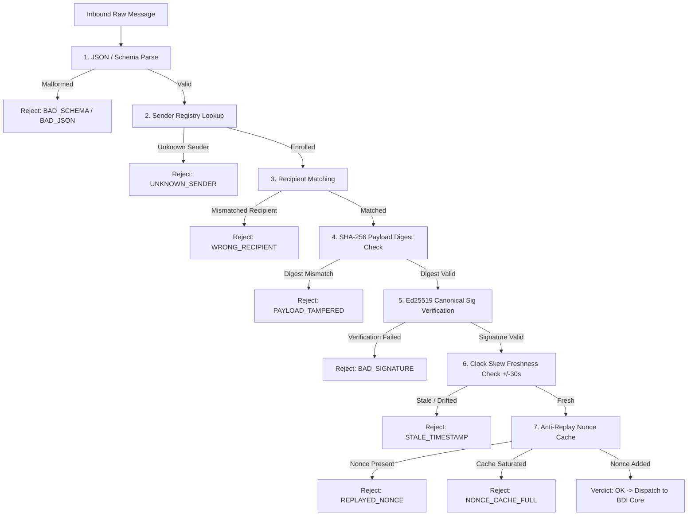

# Assignment 5.1 — Cryptographic Security Gate Audit Log

**Course:** 21CSE525T — Agent Technology  
**Student:** R Ganesh [RA2212704010031]  
**Milestone:** Assignment 5.1 (Cryptographic Message Authentication & Security Gate)  
**Execution Date:** 2026-10-21  

---

## 1. Security Gate Verification Matrix

The inbound `SecurityGate` enforces strict fail-closed, multi-stage validation prior to
passing envelopes to the agent's core BDI reasoning logic.

| Scenario | Sender | Attack / Verification Vector | Expected Code | Actual Code | Agent Shield Status | Verdict |
|---|---|---|---|---|---|---|
| **1. Nominal Valid Message** | `sensor-agent-01` | None (Legitimate telemetry) | `OK` | `OK` | Processed (Beliefs updated) | **PASS** |
| **2. Untrusted Sender** | `rogue-agent-99` | Rogue agent spoofing command | `UNKNOWN_SENDER` | `UNKNOWN_SENDER` | Shielded (ERROR response emitted) | **PASS** |
| **3. Wrong Recipient** | `supervisor-agent-01` | Misrouted / Confused deputy packet | `WRONG_RECIPIENT` | `WRONG_RECIPIENT` | Shielded (ERROR response emitted) | **PASS** |
| **4. Tampered Payload** | `sensor-agent-01` | MITM tampering of payload parameters | `PAYLOAD_TAMPERED` | `PAYLOAD_TAMPERED` | Shielded (ERROR response emitted) | **PASS** |
| **5. Bad Signature** | `supervisor-agent-01 (forged)` | Impersonation with forged/invalid signature | `BAD_SIGNATURE` | `BAD_SIGNATURE` | Shielded (ERROR response emitted) | **PASS** |
| **6. Stale Timestamp** | `sensor-agent-01` | Expired packet injection / Clock desync | `STALE_TIMESTAMP` | `STALE_TIMESTAMP` | Shielded (ERROR response emitted) | **PASS** |
| **7. Replayed Envelope** | `sensor-agent-01` | Eavesdropped packet re-transmission | `REPLAYED_NONCE` | `REPLAYED_NONCE` | Shielded (ERROR response emitted) | **PASS** |
| **8. Cache Saturation** | `sensor-agent-01` | Resource exhaustion / Cache flood | `NONCE_CACHE_FULL` | `NONCE_CACHE_FULL` | Shielded (Fail-closed defensive stop) | **PASS** |

---

## 2. Inbound Security Gate Stage Pipeline

---

## 3. Deliberative Integrity Guarantee

- **Zero Belief Pollution:** During breach attempts (Scenarios 2–8), the `AnalystAgent` discarded unvetted messages before they touched `BeliefBase` or triggered deliberation.
- **Canonical Signing:** Signatures bind sender, recipient, timestamp, performative, message ID, and SHA-256 digest of canonically serialized payload.
- **Fail-Closed Stance:** If the anti-replay cache reaches capacity, unknown messages are strictly rejected (`NONCE_CACHE_FULL`), preventing memory overflow and acceptance.
