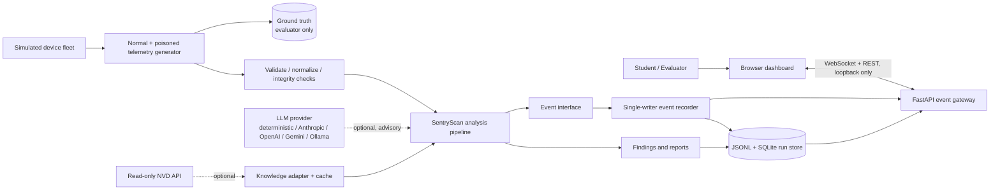
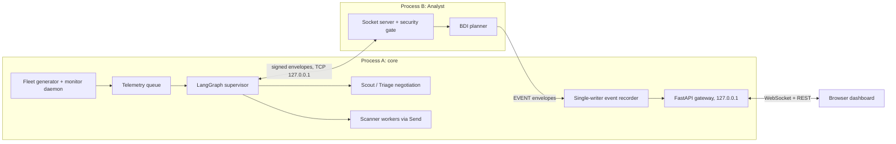
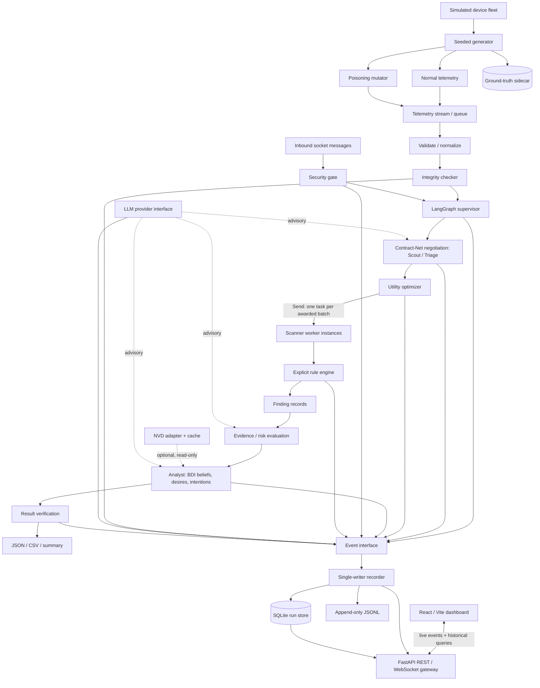
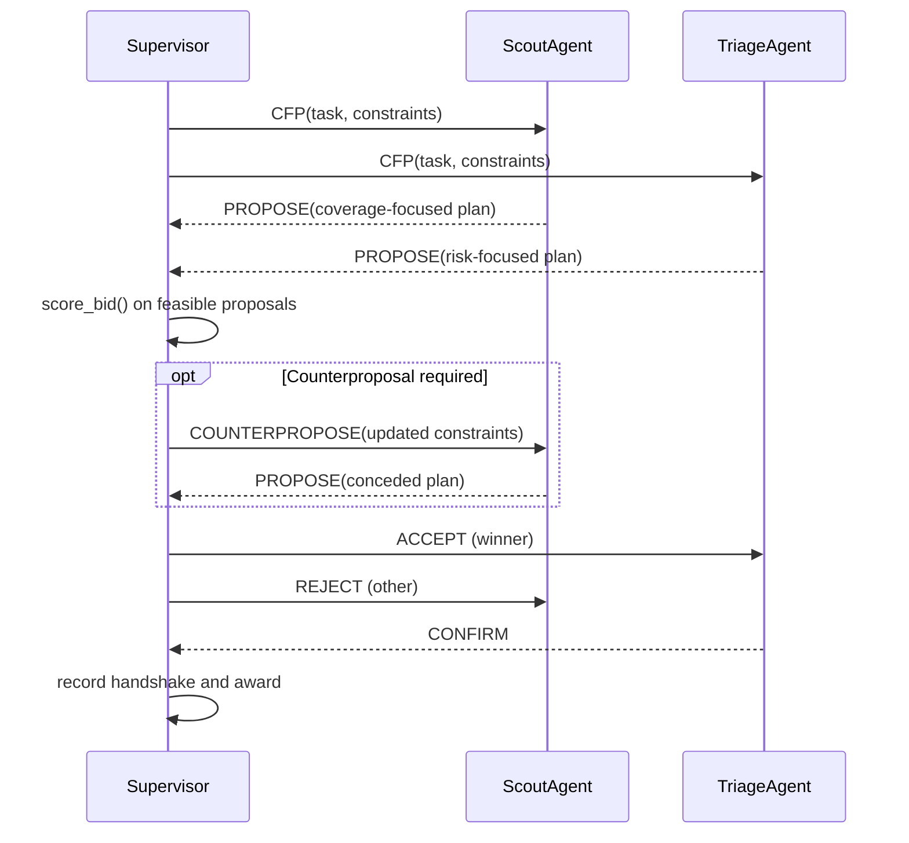

# SentryScan — High-Level Design (HLD)

**Course:** 21CSE525T — Agent Technology  
**Project:** SentryScan — Authorized Vulnerability Scanner Agent (synthetic-only simulation)  
**Document status:** Draft HLD **v1.2** (supersedes v1.1) — adds a provider-switchable LLM layer, full agent/message visibility with a fluid communication animation, a defined process and event model, a data-integrity (poison-detection) component, a determinism contract, effort tiers, and a revised commit plan  
**Date:** 2026-10-20  
**Plan baseline:** Clean slate. 0 of 10 assignments are completed or submitted.  
**Implementation language:** Python 3.11+  
**Orchestration:** LangGraph, introduced in Assignment 3.1  
**Repository strategy:** One GitHub monorepo, progressive commits per assignment, immutable assignment tags, one reproducible GCR package per assignment.

---

## 0. Executive Summary

SentryScan grows from one deterministic rule-based reflex agent into a controlled multi-agent system that analyses **synthetic** security telemetry. It is built as one continuously evolving codebase across ten graded assignments. Every assignment ends with a runnable demo, captured evidence, an immutable Git tag and a ZIP built from that tag.

### 0.1 Owner-mandated requirements and where they are covered

| ID | Requirement | Designed in | Proven by |
|---|---|---|---|
| **M1** | Switch LLM provider through configuration, with no code change; deterministic mode stays the default | §7 | Provider contract suite (E1); 5.2 demo runs the same seed with two providers |
| **M2** | Every agent call, inter-agent message and LLM call is persisted **and** visible in the browser | §8.1, §8.3, §8.5 | 5.2 event-parity test (stored count equals UI-retrievable count, no `seq` gaps) |
| **M3** | Fluid, animated visualisation of agent-to-agent communication | §8.4 | 5.2 animation acceptance checks and demo video |
| **M4** | Multi-device normal and poisoned telemetry, with ground truth kept away from the agents | §6 | 2.1 evaluator metrics; 5.2 live fleet view |
| **M5** | Persistent run inspection and replay after the run or after a browser disconnect | §8.2, §8.3 | 5.2 reopen-after-disconnect test |
| **M6** | GitHub history of small commits per assignment, immutable tags, ZIP built from the tag | §15 | Tags, commit log, archive checksum |

### 0.2 Effort and scope tiers

Estimates are planning figures, not measurements. Revisit them after Assignment 1.2.

- **R — rubric-critical:** what the assignment brief grades. About **32 h**.
- **P — project-mandated:** M1–M5 above (LLM layer, poisoning, SQLite, gateway, frontend, basic animation). About **27 h**.
- **S — polish:** advanced animation effects and run comparison. About **5 h**.
- **Total ≈ 64 h focused, ≈ 95 h with a 1.5× buffer.** At 3–4 h/day, R-tier alone is about 8–11 days and the full plan about 16–21 days. Per-assignment figures are in §14.
- **Cut order if time runs short:** S-tier effects first, then run comparison, then secondary dashboard views. **Never cut** the message/event inspector, event persistence, the security gate, or any R-tier item. The Rich CLI dashboard is the fallback for the 5.2 UI line.

### 0.3 What changed from v1.1

| Change | Where |
|---|---|
| Added provider-switchable LLM layer (`llm/`), deterministic by default | §3, §7, §14 (3.1, E1) |
| Added explicit "everything is visible in the UI" coverage rule and event-parity test | §8.5 |
| Added fluid communication animation spec (view-only, driven by recorded events) | §8.4 |
| Defined process topology (core process, Analyst process, browser) and a **single-writer event recorder with `seq`** | §5.1, §8.1 |
| Added `IntegrityChecker` and evaluator for poisoned data; separated it from message authentication | §6 |
| Added determinism contract (injectable clock, seeded IDs, normalized-trace diff) | §10 |
| Fixed ordering: negotiation now precedes `Send` fan-out; defined the `Proposal` object and a `score_bid()` seam so 3.1 can ship before 3.2 | §9, §11 |
| Hardened signing: canonical bytes, `receiver` signed, bounded nonce cache, demo key handling | §12 |
| Moved poisoning and fleet from 1.2 to 2.1; SQLite from 1.2 to 5.2 (JSONL until then) | §14, §15 |
| Added the Unit-1 paradigm reference to the 1.1 Agent-vs-OOP comparison | §14, §15 |
| Added effort tiers, deadline check, CI, secret scanning, merge-type rule | §0.2, §15, §16, §19 |
| Fixed v1.1 inconsistencies: `source` values, `host_id` vs `device_id`, math rendering, Mermaid-to-PDF export, documentation-only IP limits | App. A, §13, §14 |
| Moved data contracts to an appendix and removed repeated dashboard text | App. A, §8 |

---

## 1. Purpose

SentryScan demonstrates, across ten assignments: PEAS and environment modelling, condition–action rules, threads and queues, socket messaging, multi-agent negotiation, utility optimisation, BDI planning, knowledge representation with API enrichment, message authentication, and capstone integration.

Each assignment adds a bounded capability, keeps the earlier implementation, adds tests and observable evidence, and finishes with a Git tag and a GCR submission package.

This HLD defines the intended final architecture and the boundaries between milestones. It does **not** claim that any planned component is implemented.

## 2. Goals and Non-Goals

### 2.1 Goals

- Show every assignment's key concept visibly in code and execution evidence.
- Keep rubric-visible primitives hand-written: condition–action rules, `threading`, `queue.Queue`, TCP sockets, the utility calculation and cryptographic verification.
- Introduce LangGraph at Assignment 3.1 for specialist nodes, conditional routing, runtime fan-out with `Send`, and multi-turn negotiation.
- Make runs reproducible under the contract in §10.
- Record every agent call, message, proposal, decision, belief update, LLM call, security rejection, timing and finding in one audit trail, and **show all of it in the browser** (M2).
- Generate normal and deliberately poisoned telemetry from a configurable simulated fleet, with ground truth isolated from the agents (M4).
- Persist enough to inspect and replay any run later (M5).
- Let the operator choose the LLM provider by configuration without touching code (M1).
- Keep a separate evidence package and a clean commit history per assignment (M6).

### 2.2 Non-goals and safety boundary

SentryScan is a **simulation and telemetry-analysis project**, not a live scanner. It never performs live network probing, port scanning, packet injection, credential cracking, exploit execution or unauthorized access. All analysis targets are synthetic fixtures. External API calls (NVD, LLM providers) are never used to select or probe a real target.

- A synthetic record is never reported as a verified real-world vulnerability. An external CVE match is contextual evidence only, reported with its source and match confidence.
- An LLM is never required for assignment-critical behavior and never holds authority over a decision (see §7.4). Graded runs use the deterministic provider. No test needs a paid model or an API key.
- Telemetry text (for example banners) is untrusted data. It must never be interpreted as an instruction by any component, including an LLM (§12.5).

---

## 3. Locked Architecture Decisions

These resolve differences between earlier planning drafts. They are the baseline unless the assignment brief requires a documented change.

| Decision | HLD baseline | Reason |
|---|---|---|
| Project identity | **SentryScan**, synthetic security-telemetry analysis agent | Consistent persona; no real-target scanning. |
| Codebase | One `sentryscan` monorepo | Later assignments and the capstone reuse earlier modules. |
| Early implementation | Assignments 1.1–2.2 are plain Python for the graded concept | Rules, threads, queues and sockets stay visible, not hidden in a framework. |
| LangGraph adoption | Starts in 3.1 | Unit 3 is where multi-agent coordination is graded. |
| **Process topology** | Process A (core + gateway), Process B (Analyst), browser. A `Transport` interface has socket and in-process adapters. | Assignment 2.2 needs two processes; tests and dev runs need an in-process mode. See §5.1. |
| Runtime subagent dispatch | Registered worker nodes with bounded per-task input; `Send` for dynamic fan-out | Visible spawning without arbitrary code generation. |
| Core decision logic | Deterministic rules, explicit utility and BDI logic are **authoritative** | Reproducible and explainable in review. |
| **LLM providers** | Own `LLMProvider` interface; adapters per provider; `deterministic` is the default and the only provider used in graded runs; LLM output is advisory | Seamless provider switching (M1) without losing reproducibility. See §7. |
| Agent roles | Supervisor, Scout, Triage, Scanner Worker, Integrity Checker, Evidence/Risk evaluator, Analyst with BDI Planner, Knowledge Adapter, Verifier/Reporter | One vocabulary across HLD, code, logs and diagrams. |
| Message envelope | One typed `Message` with `performative`, identifiers, timestamp, nonce, payload and optional signature | Reused by sockets, negotiation, event forwarding and the security gate. |
| **Negotiation** | Contract-Net-inspired CFP → PROPOSE → COUNTERPROPOSE → ACCEPT/REJECT → CONFIRM over a concrete `Proposal` object; negotiation happens **before** worker fan-out | Gives the exchange real content and lets utility score it. See §11. |
| API enrichment | NVD CVE API as primary read-only source, local cache/fixture fallback | The demo never depends on the network. |
| Message authentication | Ed25519 signatures over canonical bytes that include `receiver`, plus trusted-sender, timestamp and replay checks | Per-agent identity; prevents redirecting a valid message to another agent. See §12. |
| **Data integrity** | A deterministic `IntegrityChecker` flags implausible telemetry; it is separate from message authentication | Poisoned data is a different problem from forged messages. See §6. |
| **Event model** | One event interface → single-writer recorder that assigns `seq` → JSONL (from 1.2), SQLite (from 5.2) and the live stream | Safe with threads and processes; replay has a true order. See §8.1. |
| **Determinism** | Contract in §10: injectable clock, seeded IDs, normalized-trace comparison | Logs must match on re-run even though timing varies. |
| Synthetic fleet | Configurable simulator with normal, mixed, poisoned and malformed modes; per-run seed; ground truth in a separate sidecar | Repeatable experiments without probing real systems. |
| Live dashboard | React/Vite frontend + FastAPI REST/WebSocket gateway bound to `127.0.0.1`; prebuilt bundle committed at the 5.2 tag; Rich CLI as fallback | Graders do not need Node; the UI is a viewer, not the system of record. |
| **Animation** | Pure view over recorded events, with its own playback clock | Animation can never lose, reorder or invent events. See §8.4. |
| Environment modelling | 1.1 documents the initial single-agent, record-oriented environment; streaming and concurrency are documented as extensions | Honest to what each prototype actually does. |
| Git milestone model | Assignment branch → small commits → PR merged with a **merge commit** (no squash, no rebase) → immutable `assignment-X.Y` tag → ZIP from the tag | Rebase rewrites hashes and squash erases staged progress. |
| **CI and secrets** | GitHub Actions from Phase 0: tests, lint, secret scanning | A leaked private key would be a serious mistake in a security course. |

---

## 4. System Context

The input environment is a **simulated fleet of fictitious devices**. A configurable generator emits normal telemetry and controlled poisoned variants. SentryScan analyses the stream, coordinates bounded agent tasks and computes a simulated security posture. All generation, processing, communication, decision and result events are persisted independently of the browser.



**Trust boundaries.** Fixture input and incoming messages are untrusted. An incoming message must pass framing, parsing and schema checks, and (from 5.1) the security gate, before its payload can influence trusted agent state. The generator's ground-truth labels live in a separate evaluator-only store, so the detector cannot read the answer key. LLM output is also untrusted until it passes schema validation (§7.5).

---

## 5. Target Architecture

### 5.1 Process topology



1. **Process A** runs the generator, daemon, queue, supervisor graph, negotiation, workers, integrity checker, optimizer, knowledge adapter, LLM layer, event recorder and gateway.
2. **Process B** is the Analyst: the socket server from 2.2, which hosts the BDI planner from 4.1. It forwards its events to Process A as `EVENT` envelopes, so there is exactly one event writer per run.
3. **The browser** is only a client. A disconnect never stops the run.
4. **`main.py --demo`** starts B, then A, and shuts both down through stop events. All ports bind to `127.0.0.1` and are configurable.
5. **Transport interface:** a `Transport` abstraction has a TCP adapter and an in-process adapter. Unit tests and `--single-process` use the in-process adapter; the 2.2 and capstone demos use TCP.
6. Before 3.1 there is no graph. Assignments 1.2–2.2 are single-purpose programs on the same shared modules.

### 5.2 Logical layers

| Layer | Components | Responsibility |
|---|---|---|
| Interface | CLI entry point; Rich CLI dashboard (fallback); React/Vite dashboard (5.2) | Starts safe simulations; the browser dashboard is the primary operator view. |
| Input / sensing | Fleet simulator; normal/poisoned generator; parser/normalizer | Emits configurable synthetic records with provenance and converts them to typed percepts. |
| Integrity | `IntegrityChecker`; evaluator-only detection metrics | Flags implausible or contradictory telemetry without reading ground truth. |
| Reflex core | Rule table; rule engine; finding model | Evaluates explicit IF–THEN rules and emits evidence-bounded findings. |
| Execution support | Monitor daemon; thread-safe queue; locked stats | Non-blocking telemetry production and consumption (2.1). |
| Communication | Message envelope; JSON framing; `Transport` interface | Localhost TCP in 2.2, later authenticated. |
| Coordination | LangGraph supervisor; Scout/Triage; scanner-worker dispatch | Negotiates allocation, fans out bounded work, gathers results. |
| Decision optimisation | Utility evaluator; hard-constraint filter | Scores feasible plans with an explicit formula. |
| Deliberation | Belief store, desires, intentions, replanning (in the Analyst) | Revises intentions when material beliefs change. |
| Knowledge | JSON ontology; NVD adapter; cache/offline fallback | Optional read-only vulnerability context. |
| LLM | `LLMProvider` interface; adapters; response cache; call budget | Optional advisory text and proposals; swappable by config (§7). |
| Security | Ed25519 signer/verifier; trusted-agent registry; freshness/replay checks | Rejects untrusted, tampered, stale or replayed messages. |
| Observability / persistence | Event interface; single-writer recorder; JSONL; SQLite; artifacts | System of record for every run. |
| Frontend | Workflow graph; communication animation; message inspector; fleet, findings, decisions, LLM calls, run log, replay | Shows everything the system did, live and afterwards. |

### 5.3 Final component diagram

The diagram shows the **capstone target only**. The recorder and generator start earlier, concurrency in 2.1, LangGraph in 3.1, the LLM interface in 3.1, the security gate in 5.1 and the dashboard in 5.2. Earlier submissions do not assume later components.



### 5.4 Agent roles and responsibilities

| Agent / component | Objective | Behaviour | LLM role | Introduced |
|---|---|---|---|---|
| **Supervisor** | Finish the run safely within limits | Splits work into batches, runs negotiation, fans out workers, collects results, terminates the graph | Advisory text only | 3.1 |
| **ScoutAgent** | Prefer broad host coverage | Proposes an allocation that maximises coverage within budget | May draft the rationale | 3.1 |
| **TriageAgent** | Prefer high-severity, high-confidence findings first | Proposes or counters with a risk-first ordering | May draft the rationale | 3.1 |
| **ScannerWorker** | Evaluate one assigned batch | Runs the plain-Python rule engine; many instances via `Send` | None | Rules in 1.2; dispatch in 3.1 |
| **IntegrityChecker** | Flag implausible telemetry | Deterministic data-level checks (§6.3) | None | 2.1 |
| **Evidence/Risk evaluator** | Keep findings traceable | Validates evidence fields; computes deterministic severity and confidence | May explain a finding | 1.2 / 3.1 |
| **Analyst** | Receive findings, hold beliefs | Socket server in 2.2; hosts the BDI planner from 4.1 | May suggest, never decide | 2.2 / 4.1 |
| **BDI Planner** | Reconcile beliefs with ranked desires | Selects and revises intentions | Advisory suggestion only | 4.1 |
| **Knowledge Adapter** | Supply optional external context | Reads cache or NVD; never probes targets | May summarise a record | 4.2 |
| **Verifier/Reporter** | Produce consistent outputs | Checks result schema; writes JSON/CSV/summary | None | 1.2 / 5.2 |
| **Event Recorder** | Make behaviour inspectable | Single writer; assigns `seq`; fans out to sinks | None | 1.2 (JSONL), 5.2 (SQLite, stream) |

`ScoutAgent` and `TriageAgent` are role configurations with deliberately different objectives. The system never generates arbitrary Python as a way to create agents.

---

## 6. Synthetic Fleet, Poisoning and Data-Integrity Checking

### 6.1 Device fleet and generator

A `DeviceFleetSimulator` models fictitious devices (`sim-host-001` to `sim-host-N`). One simulated device emits telemetry for exactly one synthetic host, so `device_id == host_id` unless a scenario says otherwise. **`host_id` is the join key everywhere.** `ip` is decorative display metadata and is never probed.

Modes (introduced in 2.1; 1.2 ships only `normal` and `malformed`):

- `normal`: internally consistent baseline records.
- `poisoned`: records mutated to simulate tampering or manipulation.
- `mixed`: normal and poisoned records interleaved across devices at runtime.
- `malformed`: invalid records for parser and resilience tests.

Injection operators (each recorded in the sidecar):

| Operator | What it simulates |
|---|---|
| `stale_timestamp` | Old data presented as current |
| `replayed_record` | A previously seen record re-emitted |
| `version_downgrade` | Banner version altered to hide or fake an exposure |
| `service_banner_mismatch` | Service and banner no longer agree |
| `tls_claim_contradiction` | TLS metadata that is impossible for the service |
| `auth_mode_flip` | Authentication state changes without a reason |
| `rate_burst` | A device emits far above its configured rate |
| `prompt_injection_banner` | Banner text containing instructions. Used only to test LLM-assisted mode (§12.5) |

Run parameters: device count, events per second, normal/poisoned ratio, scenario profile, operators enabled, duration or event limit, and seed. Values are bounded to protect the machine. Fleets above about 750 devices use the IPv6 documentation prefix `2001:db8::/32` for display addresses, because the three IPv4 documentation ranges hold roughly 750 usable hosts.

### 6.2 Ground-truth isolation

For every record the generator writes a ground-truth row (`record_id`, `device_id`, injection type, modified fields, expected classification, `parent_record_id`, seed) to an **evaluator-only** store. Agents, negotiation participants, the BDI planner and any LLM prompt never receive these fields. A test asserts that every agent-facing payload and every LLM prompt omits them. The raw baseline and the mutated record are stored separately and linked, never overwritten.

### 6.3 Integrity checker

`IntegrityChecker` is a deterministic, rules-as-data component in the same style as the rule engine. It decides whether telemetry is **plausible**; it does not read ground truth.

| Check | Catches | Reason code |
|---|---|---|
| Freshness | `generated_at` outside the allowed window or going backwards per device | `STALE_RECORD` |
| Duplication | Repeated `record_id` or identical payload hash from one device inside a window | `REPLAYED_RECORD` |
| Cross-field consistency | Banner product/version versus `service`; TLS claimed on a plaintext-only service; port versus service | `FIELD_CONTRADICTION` |
| Device baseline drift | Banner, service or auth mode changing on one `host_id` without a scenario event | `BASELINE_DRIFT` |
| Rate anomaly | Emission rate far above the device profile | `RATE_ANOMALY` |
| Untrusted text | Banner content that looks like an instruction | `SUSPECT_TEXT` |

A flagged record is **not** dropped. It continues through analysis marked `suspect`, and findings carry its `integrity_flags`. Every flag is an `integrity_flag` event with `record_id`, `check_id`, `reason_code` and `confidence`.

### 6.4 Integrity checker versus security gate

| | Integrity checker (2.1) | Security gate (5.1) |
|---|---|---|
| Question | Is this telemetry plausible? | Did a trusted agent really send this message? |
| Input | Telemetry records | Inter-agent messages |
| Mechanism | Rules over data and per-device history | Signatures, registry, freshness, nonce |
| Failure | Record marked `suspect` | Message rejected before dispatch |

### 6.5 Detection evaluation

An evaluator-only job joins integrity flags with ground truth and reports true/false positives, false negatives, detection latency and per-operator recall. It runs after or alongside a run, never inside the agent path.

**Honest limitation:** poisoning that is internally consistent and consistent with the device's own history is invisible to these checks. It appears as a false negative, and the report states that as an expected result, not a defect.

---

## 7. LLM Provider Layer (M1)

### 7.1 Principles

1. **Provider is configuration, not code.** Switching provider is a config, environment or CLI change. No source edit and no change to agent logic.
2. **Deterministic by default.** Graded runs, CI and unit tests use the `deterministic` provider or a `FakeProvider`. No API key is ever needed to pass a test or reproduce an assignment.
3. **Advisory, not authoritative.** Rules, utility, BDI selection, integrity checks and the security gate decide. An LLM may draft explanations or proposals that are then validated.
4. **Every call is observable.** Each LLM call is a persisted event and appears in the dashboard (M2).

### 7.2 Provider interface

An `llm/` package owns the abstraction. The shape below is illustrative; exact fields are fixed in the LLD.

```python
class LLMProvider(Protocol):
    name: str
    def complete(self, request: LLMRequest) -> LLMResponse: ...

@dataclass(frozen=True)
class LLMRequest:
    role: str                # e.g. "triage_proposal", "finding_explanation"
    system: str
    messages: list[dict]     # provider-neutral {role, content}
    response_schema: dict | None
    max_tokens: int
    temperature: float       # default 0.0
    request_id: str

@dataclass(frozen=True)
class LLMResponse:
    text: str
    parsed: dict | None      # present when a schema was requested and validated
    provider: str
    model: str
    tokens_in: int
    tokens_out: int
    latency_ms: int
    cache_hit: bool
    finish_reason: str
```

Adapters in the planned first set: `deterministic`, `fake` (scripted, for tests), `anthropic`, `openai`, `gemini`, `ollama` (local). The first-day provider list is an assumption to confirm (§19). Each adapter may wrap a vendor SDK or a library such as LangChain chat models or LiteLLM; that choice is made in the LLD against these criteria: pinned versions, no hidden global state, timeouts, token-usage reporting, easy mocking. The provider interface, not any library, is what the rest of the code imports.

### 7.3 Configuration and switching

```yaml
# config/llm.yaml
llm:
  provider: deterministic     # deterministic | anthropic | openai | gemini | ollama | fake
  model: ""                   # provider-specific, never hard-coded in source
  mode: live                  # live | record | replay
  temperature: 0.0
  timeout_s: 20
  max_retries: 2
  max_calls_per_run: 200
  max_tokens_per_call: 800
  fallback: deterministic
  roles:                      # optional per-role overrides
    triage_proposal:     { provider: openai }
    finding_explanation: { provider: ollama }
```

- **Ways to switch:** edit `config/llm.yaml`; set `SENTRYSCAN_LLM_PROVIDER`; pass `--llm-provider`; or (P-tier) pick a provider in the dashboard's run-setup panel. The dashboard choice is applied server-side to the **next** run. Keys never reach the browser.
- **No mid-run switching.** A run uses one provider configuration so that its record stays reproducible. Per-role overrides give finer control inside that configuration.
- **Secrets:** API keys come from provider-specific environment variables (for example `ANTHROPIC_API_KEY`, `OPENAI_API_KEY`) loaded from a git-ignored `.env`. `config/llm.example.yaml` and `.env.example` are committed; real values are not. Ollama needs no key and defaults to a loopback address.

### 7.4 Where an LLM may and may not act

| Allowed (advisory, schema-validated) | Never allowed |
|---|---|
| Drafting a Scout or Triage proposal rationale | Evaluating detection rules |
| Explaining a finding or decision in plain language | Computing utility or choosing the winning option |
| Suggesting a BDI intention (the planner accepts or rejects it) | Deciding signature, registry, nonce or timestamp checks |
| Summarising a CVE record from the knowledge adapter | Reading ground-truth labels or private keys |
| | Executing tools, making network calls, or changing configuration |

### 7.5 Guardrails

1. **Schema validation.** Any response used by the system must parse against its `response_schema`. Invalid output is discarded.
2. **Deterministic fallback.** On timeout, error, budget exhaustion or invalid output, the system uses the deterministic provider and logs a `llm_call` event with `fallback_used=true`. A run never fails because a provider is down.
3. **Budget.** `max_calls_per_run`, per-call token limits and a running cost counter bound spend. Hitting the cap switches to the fallback and raises a visible event.
4. **Prompt-injection stance.** Prompts wrap telemetry as quoted data and state that it is not an instruction. Because poisoned banners may contain injection text, the `prompt_injection_banner` operator exists to test this. LLM output can never alter a security decision or trigger an action by itself.
5. **No sensitive material in prompts.** Ground truth, private keys and environment secrets are excluded. A test checks this.

### 7.6 Modes and reproducibility

| Mode | Behaviour | Use |
|---|---|---|
| `live` | Calls the provider | Exploration |
| `record` | Calls the provider and stores each response in a cache keyed by a hash of the request | Capturing a demo |
| `replay` | Serves responses from the cache only; no network | Reproducing an LLM-assisted run offline |
| deterministic provider | Produces template text from rule and evidence metadata; no network | Graded runs and CI |

### 7.7 Observability

Each call emits an `llm_call` event with: `provider`, `model`, `role`, `agent_id`, `task_id`, `prompt_ref`, `response_ref` (full payloads stored as artifacts and resolvable by ID), `tokens_in`, `tokens_out`, `latency_ms`, `cost_estimate`, `cache_hit`, `fallback_used`, `status`. The dashboard shows these in the workflow graph, the message animation and an LLM-calls view (§8.3).

### 7.8 Testing and delivery

- A **provider contract suite** runs the same behavioural tests against every adapter with HTTP mocked: request shaping, timeout, retry, schema failure, fallback, token accounting. Live tests are opt-in (`pytest -m live`) and skip without keys.
- **Delivery:** the interface, `deterministic` and `fake` providers land in 3.1 so negotiation can use them. Real adapters, cache and record/replay land in enabler branch **E1** (§14), reusing the timeout, retry and cache patterns from 4.2. E1 is not a graded assignment and has no GCR upload.

---

## 8. Observability, Persistence and the Live Frontend (M2, M3, M5)

The frontend is a **viewer of the persisted record**, not the record itself. Requirements here are core architecture, not dashboard decoration.

### 8.1 Event pipeline

1. Any component calls `bus.emit(event)`. The call enqueues into a bounded in-memory queue and does not touch storage.
2. A single `EventRecorder` thread (in Process A) is the only writer. It assigns a per-run, gap-free, monotonic **`seq`**, writes JSONL (from 1.2) and SQLite (from 5.2), then hands the event to the live broadcaster.
3. Events from Process B arrive as `EVENT` envelopes and are recorded the same way, so cross-process order is the recorder's order.
4. **`seq` is the ordering authority.** Timestamps are informational. Replay and the UI order by `seq`.
5. **Back-pressure:** if the recorder queue fills, `emit` blocks briefly and then marks the run `evidence_incomplete` with a visible error. Events are never silently dropped.
6. **Slow browser clients** have bounded per-client queues. An overflowing client receives a `resync` notice and backfills from the store by `seq`. The run is never slowed by the browser.
7. Secrets and private keys are redacted before an event is written. Synthetic telemetry and non-sensitive decision evidence are not redacted.

### 8.2 Persistence

Every run has a unique `run_id`. Everything links back to it.

- **JSONL trace:** append-only, one event per line, portable export. Used from Assignment 1.2.
- **SQLite run store:** indexed, queryable records for the entities in Appendix A.7. Added as a second sink in 5.2 with no change to emitters.
- **Artifact directory per run:** raw and normalized telemetry, ground-truth sidecar, full logs, metrics CSV, reports, state snapshots, prompts and responses, exported trace.
- **Run manifest:** timestamp, seed, simulation and LLM configuration, app version / Git commit, dependency versions, enabled integrations. It makes a result reproducible.
- Large payloads are stored once and referenced by ID (`input_ref`, `output_ref`, `prompt_ref`, `response_ref`). References must always resolve.
- Run data and the SQLite file are Git-ignored. Only small deterministic fixtures and sanitised representative evidence are committed.

### 8.3 Dashboard views

Served by FastAPI on `127.0.0.1`. REST serves history; WebSocket pushes live events. Polling or manual refresh alone does not satisfy the design.

1. **Live workflow graph:** each agent or node shows queued, running, completed, failed or waiting; active edges show handoffs and durations.
2. **Communication inspector:** every message with sender, receiver, `seq`, timestamps, message and task IDs, performative, payload, response and outcome. Negotiation turns (CFP, PROPOSE, COUNTERPROPOSE, ACCEPT/REJECT, CONFIRM) appear as they happen.
3. **Device fleet and data stream:** device list and status, incoming rate, normal-versus-poisoned mix, processing state, per-device findings. Raw and normalized record side by side.
4. **Findings and posture:** severity distribution, evidence links, confidence, per-device posture over time, and detection metrics against the isolated ground truth.
5. **Decision inspector:** triggering rule, relevant input fields, reason codes, integrity flags, utility values and constraints, proposal comparison, belief changes, current intention and the replan explanation.
6. **LLM calls:** provider, model, role, prompt, response, tokens, latency, cost, cache and fallback status for each call.
7. **Run log and replay:** searchable, filterable timeline (run, time range, device, agent, task, event type, severity, status), exceptions, rejected messages, retries, API/cache state, counters, links to artifacts. Reopen a finished run, scrub the timeline, inspect any event, and compare runs with different seeds or poison ratios. Replay **reads recorded events**; it never reruns or mutates the original run.

"Show the agent's thinking" means exposing **observable execution and decision evidence**: which node ran, what it consumed, which rule or calculation applied, a concise reason, state before and after, any API or LLM request and outcome, and the message it emitted. It does not mean capturing hidden model chain-of-thought.

### 8.4 Communication animation (M3)

A dedicated view animates agent-to-agent communication fluidly while staying a pure function of the recorded event stream.

**Visual language**

- Agents are nodes on a canvas with a status ring. Edges are curved, glowing paths.
- Every `message_sent` creates a **particle with a trailing ribbon** that travels along its edge. Colour encodes the performative family (negotiation, alert/task, security, LLM, knowledge, data). Size encodes payload size on a log scale. Shape, not colour alone, also distinguishes families.
- A negotiation round shows paired back-and-forth ripples between the two parties. A completed handshake ends in a merge burst on the winning edge.
- A message rejected at the security gate breaks apart at the gate and pulses red, with its reason code shown.
- An LLM call sends an outward pulse ring from the calling agent, with a provider badge. A deterministic fallback shows as a distinct badge.
- Poisoned records are visibly tinted in the data stream. A BDI intention change morphs the active-intention indicator and shows before and after.

**Behavioural rules**

1. **Event-driven and deterministic.** The animation state is `reduce(events up to the playback position)`. Animation never creates, reorders or drops an event.
2. **Own playback clock.** Live-follow, pause, scrub and speed from 0.25× to 8×. Replay uses recorded `seq` order and recorded durations.
3. **Coalescing is visual only.** Bursts may merge into one particle with a count badge (for example ×37) to hold the frame rate. The inspector list is windowed from the store and always shows every event.
4. **Click and hover.** Hover a particle for a summary; click it to open the full message in the inspector. Click a node to drill into that agent's events, beliefs and intention.
5. **Filters.** Toggle performative families; the animation and the inspector share the filter state.
6. **Performance budget.** 60 fps with about 200 simultaneous particles on a laptop, enforced by a particle cap and coalescing.
7. **Accessibility.** Honour `prefers-reduced-motion` with a static mode (arrows, labels, counts). Colour-blind-safe palette.
8. **Technology** (Canvas 2D, WebGL via a library, or SVG) is chosen in the LLD against the performance budget.

**Tiers:** the basic particle flow and click-through are P. Ribbons, ripples, rejection shatter, LLM pulses, morphs and run comparison polish are S.

### 8.5 Coverage rule and parity test

Everything persisted is reachable from the UI.

1. Every `AgentEvent`, `Message` and `llm_call` stored for a run can be retrieved through the REST API and opened in the inspector.
2. Every message-type event is animated or counted in a coalesced badge.
3. **5.2 parity test:** for a run, the number of rows in SQLite, the number of lines in the exported JSONL and the number of events retrievable through the UI API are equal, and `seq` has no gaps. The UI displays the total from the gateway so a mismatch is visible.

### 8.6 Hosting

The gateway binds to `127.0.0.1` only. A prebuilt `frontend/dist` is committed in a dedicated `build(a5.2)` commit and served by FastAPI, so a grader needs no Node toolchain. Developers use Vite. A single static page with a WebSocket is acceptable if it meets §8.3–§8.5. The Rich CLI dashboard remains as the fallback and for headless runs.

---

## 9. Runtime Workflow

### 9.1 End-to-end capstone run

1. **Start run:** create `run_id`; persist the manifest (seed, fleet, mix, rate, LLM config, version); start the recorder, gateway and Analyst process.
2. **Generate:** the fleet emits normal, poisoned, mixed or malformed synthetic records. Each is persisted with provenance; ground truth goes to the evaluator-only store.
3. **Queue:** the daemon feeds records through a `queue.Queue`. The consumer records queue wait and processing latency.
4. **Validate and check integrity:** parse and normalize; reject malformed records with an event; flag implausible records `suspect`.
5. **Message gate:** inbound inter-agent messages pass framing, size and schema checks, and from 5.1 the full security gate, before dispatch.
6. **Create work items:** the supervisor groups independent records into bounded batches.
7. **Negotiate allocation:** the supervisor sends a CFP; Scout and Triage return `Proposal` objects; the supervisor scores them with `score_bid()` (the 3.2 optimizer once present), may counter-propose, and awards the task after ACCEPT and CONFIRM. A hard round limit applies.
8. **Fan out:** `Send` invokes the registered scanner-worker node once per awarded batch.
9. **Analyse:** each worker runs the visible IF–THEN rules and returns findings with evidence references. Evidence/risk evaluation may run separately.
10. **Report to Analyst:** findings travel as signed `ALERT` envelopes to Process B.
11. **Enrich (optional):** the knowledge adapter reads the cache first, or performs a read-only NVD lookup if enabled. Failure falls back to the cache and is logged.
12. **Deliberate and replan:** the BDI planner updates beliefs, ranks desires and keeps or changes its intention. A critical finding must produce an observable intention change. Optional LLM suggestions are validated first.
13. **Verify and report:** the verifier checks consistency; the reporter writes console, JSON, CSV and summary artifacts.
14. **Close run:** flush the recorder, emit metrics, mark the run complete or `evidence_incomplete`, print a deterministic summary.

### 9.2 Control-flow rules

- Every loop is bounded: workers, retries, negotiation rounds, API and LLM timeouts, message size, nonce-cache size, queue length.
- Every task returns a structured result or a structured failure. A missing result is never converted into success.
- Consensus is recorded only when the protocol's accept-and-acknowledge condition is met. At the round limit, log `UNRESOLVED` and terminate safely.
- A missing API or LLM connection must not stop the core fixture demo.
- A denied security check is logged and never enters the graph as a trusted instruction.

---

## 10. Determinism and Reproducibility Contract

Threads and wall-clock time are not reproducible, so the contract states exactly what must match.

**With the same seed, configuration and `deterministic` provider, these must be identical across runs:** generated telemetry, normalized records, integrity flags, rule matches and findings, negotiation sequence and content, utility scores and winner, BDI intention sequence, security verdicts and reason codes, and report content.

**These may differ:** wall-clock timestamps, durations and latencies, thread names, and the global interleaving of events produced by concurrent stages (2.1 and the daemon). For concurrent stages the evidence compares totals and per-device order, not timing.

**Mechanisms**

1. **Injectable `Clock`** (`SystemClock`, `FakeClock`). Freshness checks, timestamps and timers all use it. Tests for the ±30 s window use `FakeClock` and never sleep.
2. **Seeded ID generation:** sequential or seeded-RNG IDs for records, messages, tasks and events. No unseeded `uuid4`.
3. **Normalized-trace comparison:** `scripts/normalize_trace.py` strips timestamps, durations and thread names and orders by `seq` within deterministic single-threaded graph runs. A test runs the same scenario twice and diffs the normalized traces.
4. **Single-threaded deterministic runs:** negotiation, optimisation and BDI demos run on the graph without timers, so their traces are fully reproducible.
5. **Pinned dependencies** (`requirements.txt`, `package-lock.json`) and the Python version recorded in the run manifest.

---

## 11. Negotiation and Utility Design

### 11.1 What is negotiated

The task is **allocating telemetry batches for analysis under a budget**. A `Proposal` is a concrete object: ordered `batch_ids`, `est_cost`, `est_time`, `est_coverage` (severity-weighted and host coverage), `risk`, and a rationale reference (Appendix A.8). Scout favours coverage; Triage favours risk-first ordering.

### 11.2 Protocol



States: `ANNOUNCED → PROPOSED → COUNTERPROPOSED (optional) → ACCEPTED → ACKNOWLEDGED`. Concession follows a documented formula per participant. The initial limit is **five rounds**. A seeded normal run must complete the handshake; a no-agreement test must end in a bounded `UNRESOLVED`.

### 11.3 The `score_bid()` seam

Assignment 3.1 precedes 3.2, but bids need a price. 3.1 ships a small `score_bid(proposal, weights, constraints) -> float`. Assignment 3.2 builds the `optimizer/` package and replaces the inline function behind the same signature in a `refactor(a3.2)` commit. The 3.1 tag is unchanged.

### 11.4 Utility optimizer

The assignment brief is the final authority on the exact equation. The baseline is a transparent weighted score over normalised terms:

$$
U(o) = w_1\,C_{severity}(o) + w_2\,C_{hosts}(o) - w_3\,Cost(o) - w_4\,Time(o) - w_5\,Risk(o)
$$

Each term is normalised to $[0,1]$, weights are validated configuration, and hard budget and time constraints remove infeasible options first:

$$
o^{*} = \arg\max_{o \in O_{feasible}} U(o)
$$

The implementation prints every candidate's component values, feasibility and score, then the winner. An independent brute-force check asserts optimality. Tests cover empty input, all-infeasible input, invalid numbers, missing fields, negative cost, zero-range normalisation and ties, plus a weight-sensitivity run showing the winner can change.

---

## 12. Security Design

### 12.1 Trust model

- A message is not trusted because it arrived over localhost.
- The trusted-agent registry maps `agent_id` to an Ed25519 public key and a status.
- Private keys never enter source control, logs or ZIPs. Tests use generated throwaway keys.
- Telemetry files are untrusted data and are schema-validated even when checked in.

### 12.2 Canonical signed bytes

Signatures cover a **canonical serialisation** of the envelope with the `signature` field excluded: UTF-8 JSON, sorted keys, no insignificant whitespace (RFC 8785 or an equivalent documented subset), with a domain-separation prefix such as `sentryscan/v1/envelope`. The signed content includes `sender`, **`receiver`**, `performative`, `message_id`, `run_id`, `task_id`, `timestamp_utc`, `nonce`, `payload` and `payload_sha256` (the SHA-256 of the canonical payload). The digest lets the gate tell a **tampered payload** from a **forged signature**. Signed payloads use integers and strings; floats are encoded as fixed-precision strings to avoid cross-platform drift.

### 12.3 Inbound validation order

1. Enforce frame length and maximum payload size at the socket boundary.
2. Decode UTF-8 and JSON with invalid-input handling.
3. Validate the envelope schema and required fields.
4. Confirm the sender exists and is trusted in the registry.
5. Confirm `receiver` equals this agent's ID.
6. Recompute the payload digest and compare it with `payload_sha256`.
7. Rebuild the canonical bytes and verify the Ed25519 signature.
8. Check timestamp freshness within ±30 s, using the injected `Clock`.
9. Reject a previously seen `(sender, nonce)`.
10. Only then dispatch the payload to the graph. Record acceptance and rejection without logging private material.

**Reason codes:** `BAD_FRAME`, `BAD_JSON`, `BAD_SCHEMA`, `UNKNOWN_SENDER`, `WRONG_RECIPIENT`, `PAYLOAD_TAMPERED`, `BAD_SIGNATURE`, `STALE_TIMESTAMP`, `REPLAYED_NONCE`, `NONCE_CACHE_FULL`.

### 12.4 Replay cache and key handling

- The nonce cache has a time limit of at least twice the freshness window and a hard size cap. Expired entries are evicted first. If the cap is still reached, the gate **fails closed** with `NONCE_CACHE_FULL` and a visible event.
- For the one-command demo, throwaway keypairs are generated at startup into memory or a git-ignored `keys/` directory. Only public keys go into the generated `trusted_agents.json`. `config/trusted_agents.example.json` is committed.
- A `.gitignore` rule, a secret-scanning step in CI and the tracked-files-only `git archive` all guard against shipping a private key.

### 12.5 LLM and prompt-injection stance

Telemetry text and LLM output are both untrusted. Banners are passed to a model only as quoted data. An LLM can never sign, approve, skip or alter a security check, and its output cannot trigger an action without passing schema validation and the deterministic component that owns the decision (§7.5).

### 12.6 Breach demonstration

Six rejections, each with its own reason code, plus one valid message accepted: forged signature (`BAD_SIGNATURE`), unknown sender (`UNKNOWN_SENDER`), tampered payload (`PAYLOAD_TAMPERED`), wrong recipient (`WRONG_RECIPIENT`), stale timestamp (`STALE_TIMESTAMP`) and replayed nonce (`REPLAYED_NONCE`). The assignment requires five; the sixth is the recipient-binding check. All appear in the audit log and the dashboard.

---

## 13. Repository and Module Design

Folders are created **when their assignment starts**. Empty future modules are not added to make the repository look complete.

```text
sentryscan/
├── README.md
├── KNOWLEDGE.md
├── requirements.txt
├── pyproject.toml
├── .gitignore
├── .env.example                 # variable names only, no values
├── .github/
│   └── workflows/ci.yml         # tests, lint, secret scanning (Phase 0)
├── config/
│   ├── demo.yaml
│   ├── llm.example.yaml
│   └── trusted_agents.example.json
├── src/
│   └── sentryscan/
│       ├── contracts/          # telemetry, device, finding, message, proposal, task, event models
│       ├── common/             # clock, deterministic ID generator, config loading
│       ├── simulation/         # fleet simulator, normal/poisoned generator, scenario seeds   (2.1)
│       ├── sensors/            # stream reader and parser/normalizer                          (1.2)
│       ├── rules/              # explicit condition-action rule engine                        (1.2)
│       ├── integrity/          # data-integrity checks and evaluator metrics                 (2.1)
│       ├── actuators/          # console, JSON/CSV reports                                    (1.2)
│       ├── concurrency/        # monitor daemon, queues, locks, metrics                       (2.1)
│       ├── transport/          # framing, TCP client/server, in-process adapter              (2.2)
│       ├── agents/             # supervisor, Scout, Triage, workers, Analyst
│       ├── negotiation/        # CFP, proposal, counterproposal, handshake                   (3.1)
│       ├── llm/                # provider interface, deterministic/fake, adapters, cache     (3.1, E1)
│       ├── optimizer/          # utility formula, feasibility, argmax                         (3.2)
│       ├── bdi/                # beliefs, desires, intentions, replanning                     (4.1)
│       ├── knowledge/          # ontology/JSON KB, NVD adapter, cache                         (4.2)
│       ├── security/           # keys, canonical bytes, signatures, trust registry           (5.1)
│       ├── graphs/             # LangGraph supervisor and specialist subgraphs                (3.1+)
│       ├── reporting/          # consistency verification and run summary
│       ├── observability/      # event bus, recorder, trace writer, metrics, snapshots      (1.2+)
│       ├── storage/            # SQLite run store and artifact manager                       (5.2)
│       ├── dashboard_gateway/  # FastAPI REST + WebSocket gateway, serves frontend/dist       (5.2)
│       ├── ui/                 # Rich CLI dashboard                                           (5.2)
│       └── cli.py
├── frontend/                   # React/Vite dashboard; dist/ committed at the 5.2 tag
├── fixtures/
│   └── telemetry/              # small versioned deterministic synthetic examples
├── assignments/
│   ├── assignment_1_1/ ... assignment_5_2/
├── demos/                      # deterministic assignment-specific entry points
├── tests/
│   ├── unit/
│   ├── integration/
│   └── fixtures/
├── data/runs/                  # per-run raw data and artifacts; git-ignored
├── storage/sentryscan.sqlite3  # local run store; git-ignored
├── keys/                       # throwaway demo keys; git-ignored
├── logs/
│   ├── examples/               # committed representative output, no secrets
│   └── README.md
├── docs/
│   ├── hld/SentryScan_HLD_v1.2.md
│   └── architecture/
├── scripts/
│   ├── run_demo.py
│   ├── package_assignment.py
│   └── normalize_trace.py
└── dist/                       # local generated ZIPs; git-ignored
```

`assignments/assignment_X_Y/` holds the assignment README, rubric-to-evidence map, deliverables and evidence. Reusable code stays under `src/sentryscan/`; source is never copied into ten folders.

**Rendering notes:** GitHub renders the Mermaid blocks and `$$` math in this file. The 1.1 PDF export must use diagrams pre-rendered to SVG or PNG, because Mermaid usually does not survive a PDF export. Host addresses use `host_id`; demo scripts refer to `sim-host-007`, not to a real-looking private IP.

---

## 14. Ten-Assignment Evolution Plan

Each assignment adds only what that stage needs. Tiers: **R** rubric-critical, **P** project-mandated, **S** polish. Hours are planning estimates (focused work, no buffer). The acceptance gate must pass before a tag is created.

| Assignment | Architectural increment | Minimum evidence / exit gate | Est. (R / P / S) | Tag |
|---|---|---|---|---|
| **P0 — Baseline** | Repo, metadata, pinned deps, CI with secret scanning, README, assignment template, packaging script, this HLD | CI green on an empty-but-runnable skeleton | 1.5 h (R) | `p0-baseline` (not submitted) |
| **1.1 — PEAS and environment** | **R:** persona, PEAS table, environment classification, Agent-vs-OOP comparison **with an explicit Unit-1 paradigm reference**, initial architecture diagram, extension note | Readable PDF; diagrams pre-rendered; full PEAS; justified classifications and limitations | 0.5 h (R) | `assignment-1.1` |
| **1.2 — Rule-based reasoner** | **R:** injectable clock and IDs, seeded telemetry (normal + malformed), parser/normalizer, explicit rule table, JSONL event recorder, sense–parse–decide–act loop, console/file actuators | Seeded run log: rule triggers, unmatched behaviour, malformed rejection (20 records, 2 malformed), stored trace | 3 h (R) | `assignment-1.2` |
| **2.1 — Concurrent daemon** | **R:** monitor daemon, `queue.Queue`, lock-protected stats, clean stop. **P:** fleet simulator, poisoning mutators with ground-truth sidecar, integrity checker, detection evaluator | Heartbeat proves non-blocking; lost-update demo with and without lock; latency CSV with p50/p95; detection metrics | 3 R + 2 P = 5 h | `assignment-2.1` |
| **2.2 — Socket messaging** | **R:** shared envelope, length-prefixed JSON over TCP, autonomous Analyst reply (`PARAMS_UPDATE`), reconnect/backoff. Transport interface with in-process adapter | Two-terminal logs; tests for malformed frame/JSON, timeout, partial frame, reconnect | 3 h (R) | `assignment-2.2` |
| **3.1 — Multi-agent coordination** | **R:** LangGraph supervisor, Scout/Triage with `Proposal` objects, CFP protocol, `Send` fan-out, inline `score_bid()`, bounded loop. **P:** `LLMProvider` interface with deterministic and fake providers | Turn-by-turn timeline; completed handshake; max-round `UNRESOLVED` test; trace identical with LLM off | 4 R + 1.5 P = 5.5 h | `assignment-3.1` |
| **3.2 — Utility optimisation** | **R:** normalised equation, constraint filter, feasible argmax, brute-force check; swaps in behind `score_bid()` | Ten-candidate table with feasibility, scores, winner; edge-case and sensitivity tests | 2 h (R) | `assignment-3.2` |
| **4.1 — BDI modelling** | **R:** separate beliefs, desires, intentions; deliberate/plan/reconsider path inside the Analyst | Reproducible injected-belief run with before/after intention and replan reason | 3 h (R) | `assignment-4.1` |
| **4.2 — Knowledge and API** | **R:** JSON ontology/KB, NVD read-only adapter, schema validation, timeout/retry/cache/offline fallback, belief feed | Live-fetch attempt or captured response, offline fallback evidence, before/after adaptation log | 3 h (R) | `assignment-4.2` |
| **E1 — LLM providers (enabler)** | **P:** Anthropic, OpenAI, Gemini, Ollama adapters; response cache; record/replay; call budget; contract suite | Same seed run under two providers; replay run offline; contract suite green | 3 h (P) | `enabler-llm-providers` (not submitted) |
| **5.1 — Authentication** | **R:** Ed25519 identities, registry, canonical bytes with `receiver` and `payload_sha256`, signature, freshness, bounded nonce cache. **P:** wrong-recipient check, fail-closed cache | Six rejections with distinct reason codes and one accepted message, all logged | 3 R + 0.5 P = 3.5 h | `assignment-5.1` |
| **5.2 — Capstone** | **R:** integrated supervisor graph, one-command demo, Rich CLI dashboard, architecture doc, README, video. **P:** single-writer recorder with `seq`, SQLite store and replay API, WebSocket gateway, React frontend (all views in §8.3), basic particle animation. **S:** ribbons, ripples, rejection shatter, LLM pulses, run comparison | One-command demo; live graph, messages, decisions, devices, LLM calls; event-parity and replay tests; reopen-after-disconnect; two-provider run; architecture doc; video | 6 R + 20 P + 5 S = 31 h | `assignment-5.2` |
| | | **Totals** | **32 R + 27 P + 5 S ≈ 64 h** | |

P-tier breakdown inside 5.2: SQLite and replay 4 h, gateway 3 h, frontend core views 10 h, basic animation 3 h.

The assignment brief remains the final authority on exact wording, equations and deliverable formats. If it differs from this baseline, update the HLD and record the decision before implementing.

---

## 15. GitHub Commit and Release Strategy (M6)

The commit history is engineering evidence. Commits correspond to real, reviewable increments, committed as the work happens: no empty commits, no fabricated or backdated timestamps, no artificial splitting of changes that do not run.

### 15.1 Branching and merging

- `main`: integrated, runnable, test-passing history. Phase 0 is committed directly to `main`.
- One short-lived branch per assignment, for example `assignment/1.2-reflex-reasoner`. Enabler work uses `enabler/<name>`.
- Open a **Pull Request** into `main` with scope, test results, evidence and rubric mapping. CI must be green.
- **Merge type: "Create a merge commit".** Do not use "Squash and merge" (it erases staged progress) or "Rebase and merge" (it rewrites commit hashes). Locally, `git merge --no-ff`.
- Tag the merge commit `assignment-X.Y` only after the acceptance gate passes on `main`.
- **Never move or re-point a tag after upload.** A genuine correction gets a new fix commit and, if the instructor needs a replacement snapshot, a new tag such as `assignment-1.2-fix1`.
- A fix to an earlier assignment is always a **new commit** on `main`, never an edit to history.

### 15.2 Commit message convention

```text
<type>(<scope>): <specific change>
```

Types: `docs`, `feat`, `fix`, `test`, `perf`, `refactor`, `build`, `security`, `chore`. Scope is the assignment (`a1.2`), `p0`, `hld`, or an enabler (`llm`).

A commit must leave the repository coherent and, where possible, runnable with its tests passing. Where a feature needs several dependent commits, either keep each runnable or have the PR state which commit first passes the full acceptance gate. The tagged commit is always fully runnable.

The **last two commits** of every assignment branch are the README with rubric map, then the captured evidence and submission checklist. Evidence is real run output only.

### 15.3 Planned commit sequences

These are the intended milestones and subjects, about 83 commits in total. Adapt only when the implementation requires it, keeping the same small-step intent. The LLD adds files touched, tests and run commands per commit.

#### Phase 0 — Baseline (`p0-baseline`)

1. `docs(hld): establish SentryScan architecture, observability and LLM-provider requirements`
2. `build(p0): add project metadata, pinned dependencies and git ignore rules`
3. `build(p0): add CI with tests, lint and secret scanning`
4. `docs(p0): add README, safety boundary and assignment folder template`
5. `build(p0): add archive packaging script`

#### Assignment 1.1 — PEAS and environment modelling

1. `docs(a1.1): define SentryScan persona and problem statement`
2. `docs(a1.1): add PEAS table and environment classification`
3. `docs(a1.1): compare agent architecture with conventional OOP and cite the Unit-1 paradigm`
4. `docs(a1.1): add initial architecture diagram, safety boundary and extension note`
5. `docs(a1.1): export final design specification PDF and rubric map`

#### Assignment 1.2 — Rule-based reasoner

1. `feat(a1.2): add injectable clock and deterministic ID generator`
2. `feat(a1.2): define telemetry record contract and seeded fixtures`
3. `feat(a1.2): generate seeded normal and malformed telemetry`
4. `feat(a1.2): implement explicit condition-action rule table`
5. `feat(a1.2): add event interface with append-only JSONL recorder`
6. `feat(a1.2): wire sense-parse-decide-act loop with console and file actuators`
7. `test(a1.2): cover rule hits, malformed and unmatched records`
8. `docs(a1.2): capture deterministic execution evidence and rubric map`

#### Assignment 2.1 — Concurrent daemon

1. `feat(a2.1): model a configurable fleet of simulated devices`
2. `feat(a2.1): add poisoning mutators and evaluator-only ground-truth sidecar`
3. `feat(a2.1): connect producers and consumer with a safe queue`
4. `feat(a2.1): run the monitor daemon with clean shutdown`
5. `fix(a2.1): guard shared statistics against lost updates`
6. `test(a2.1): demonstrate lost updates without the lock and a non-blocking heartbeat`
7. `feat(a2.1): add deterministic integrity checks for suspect records`
8. `feat(a2.1): score integrity flags against ground truth`
9. `perf(a2.1): record queue latency and worker turnaround metrics`
10. `docs(a2.1): add fleet-stream evidence, detection metrics and rubric map`

#### Assignment 2.2 — Socket messaging

1. `feat(a2.2): define reusable agent message envelope and performative set`
2. `feat(a2.2): add length-prefixed JSON socket transport`
3. `feat(a2.2): add transport interface with in-process adapter for tests`
4. `feat(a2.2): implement autonomous Analyst response`
5. `test(a2.2): cover timeout, partial and malformed frames, and reconnects`
6. `docs(a2.2): capture two-terminal demonstration and rubric map`

#### Assignment 3.1 — Multi-agent coordination

1. `build(a3.1): add pinned LangGraph dependency and typed graph state`
2. `feat(a3.1): add LLM provider interface with deterministic and fake providers`
3. `feat(a3.1): implement supervisor, Scout and Triage roles with proposal objects`
4. `feat(a3.1): add CFP, proposal, counterproposal and handshake protocol with inline score_bid`
5. `feat(a3.1): dispatch scanner workers for awarded batches with Send`
6. `test(a3.1): verify consensus, bounded unresolved termination and identical traces with LLM off`
7. `docs(a3.1): add complete negotiation timeline and rubric map`

#### Assignment 3.2 — Utility optimisation

1. `feat(a3.2): implement normalized utility equation`
2. `feat(a3.2): filter infeasible plans and select feasible argmax`
3. `test(a3.2): cover invalid inputs, ties and boundary cases`
4. `test(a3.2): verify optimizer against independent exhaustive search`
5. `refactor(a3.2): replace inline score_bid with the optimizer`
6. `docs(a3.2): report ten candidate scores and weight sensitivity`

#### Assignment 4.1 — BDI modelling

1. `feat(a4.1): introduce separate beliefs, desires and intentions`
2. `feat(a4.1): implement deliberation and intention selection`
3. `feat(a4.1): route the Analyst graph through reconsideration and replanning`
4. `test(a4.1): prove intention changes after a critical belief update`
5. `docs(a4.1): capture BDI transition evidence and rubric map`

#### Assignment 4.2 — Knowledge representation and API

1. `feat(a4.2): add structured vulnerability knowledge ontology`
2. `feat(a4.2): implement read-only NVD adapter and response validation`
3. `feat(a4.2): add cache, timeout, retry and offline fallback`
4. `feat(a4.2): feed knowledge updates into beliefs and replanning`
5. `test(a4.2): verify online and offline enrichment paths`
6. `docs(a4.2): capture knowledge adaptation evidence and rubric map`

#### Enabler E1 — LLM providers (`enabler-llm-providers`)

1. `feat(llm): add Anthropic, OpenAI, Gemini and Ollama adapters behind the provider interface`
2. `feat(llm): add response cache, record and replay modes, and call budget`
3. `test(llm): run provider contract suite against mocked HTTP for every adapter`
4. `docs(llm): document provider switching and key handling`

#### Assignment 5.1 — Authentication and integrity

1. `security(a5.1): add per-agent Ed25519 identity and trusted registry`
2. `security(a5.1): sign canonical envelope bytes including receiver and payload digest`
3. `security(a5.1): verify signatures before dispatch`
4. `security(a5.1): enforce timestamp freshness and a bounded fail-closed nonce cache`
5. `test(a5.1): reject forged, tampered, unknown, wrong-recipient, stale and replayed messages`
6. `docs(a5.1): capture security gate results and rubric map`

#### Assignment 5.2 — Capstone

1. `feat(a5.2): integrate assignment modules into the supervisor graph`
2. `feat(a5.2): add one-command demo launching the Analyst and core processes`
3. `feat(a5.2): add Rich CLI dashboard as fallback view`
4. `feat(a5.2): add single-writer event recorder with sequence numbers`
5. `feat(a5.2): persist complete run history in SQLite and JSONL artifacts`
6. `feat(a5.2): stream events through a loopback WebSocket gateway with resync by sequence`
7. `feat(a5.2): build live frontend shell, workflow graph and message inspector`
8. `feat(a5.2): add device fleet, findings and security posture views`
9. `feat(a5.2): add decision inspector, LLM call view and searchable run log`
10. `feat(a5.2): add fluid communication animation driven by recorded events`
11. `feat(a5.2): add run replay and run comparison`
12. `test(a5.2): verify persistence, event parity, resync, replay consistency and trace reproducibility`
13. `build(a5.2): add prebuilt dashboard bundle served by the gateway`
14. `docs(a5.2): add final architecture and demonstration script`
15. `docs(a5.2): record final run evidence and submission checklist`

### 15.4 Tags, packaging and submission

Tags: `assignment-1.1` … `assignment-5.2`, plus the non-submitted `p0-baseline` and `enabler-llm-providers`. Each assignment tag identifies the exact state used for that GCR submission. Build the ZIP **from the tag**, never from a working directory:

```bash
git switch main
git pull --ff-only
mkdir -p dist

git archive --format=zip \
  --prefix=SentryScan_Assignment_1_2/ \
  --output=dist/SentryScan_Assignment_1_2.zip \
  assignment-1.2
```

`scripts/package_assignment.py` wraps this, prints the SHA-256 and records it. The ZIP contains tracked files only, so caches, virtual environments, keys and untracked files are excluded. Open the ZIP and confirm its contents before uploading.

After upload, record in the tracker: tag, archive checksum, upload status and submission date. **A commit is not proof of a GCR upload**; Git completion and academic submission are separate checklist items.

---

## 16. Testing, Reproducibility and Acceptance Gates

### 16.1 Test strategy

- **Unit:** telemetry validation, rule matches, integrity checks, utility maths, BDI transitions, envelope serialisation, canonical bytes, signatures, report schemas.
- **Integration:** producer/consumer threads; client/server round trip; negotiation exchange; NVD adapter with mocked response and cache; security gate on the transport; final supervisor run; gateway and recorder.
- **Negative:** malformed telemetry, unknown performative, bad frames, no feasible candidate, API timeout, LLM timeout and invalid output, untrusted sender, bad signature, tampered payload, wrong recipient, stale timestamp, replay, full nonce cache.
- **Determinism:** run a scenario twice and diff normalized traces (§10).
- **Isolation:** assert agent-facing payloads and LLM prompts omit ground-truth fields.
- **Provider contract suite:** the same tests against every adapter with HTTP mocked. Live tests are opt-in.
- **UI and gateway (5.2):** event-parity test, `seq` gap check, resync after a forced client disconnect, replay equals recorded order, animation reducer is a pure function of events.
- **Evidence capture:** console logs, JSONL trace excerpt, CSV metrics, reports, screenshots or video where the assignment requires them.

### 16.2 Continuous integration

From Phase 0, a GitHub Actions workflow runs on every PR: install pinned dependencies, run `pytest`, run the linter, and run a secret scanner (for example gitleaks). From 5.2 it also builds the frontend and lints it. A PR does not merge with a red check.

### 16.3 Global definition of done per assignment

An assignment is tagged only when all applicable items are complete:

- [ ] The implementation or design artifact matches the assignment brief.
- [ ] It runs from documented instructions on the supported Python version.
- [ ] Unit and integration tests for the new behaviour pass, and CI is green on the PR.
- [ ] The required behaviour is shown in a captured deterministic run (normalized trace reproduces where §10 requires it).
- [ ] The assignment README maps each rubric line to a file, test, output or document section.
- [ ] The safety boundary and synthetic-only provenance are preserved.
- [ ] No secrets, private keys, personal data or unsupported claims are in committed files or logs; secret scan is clean.
- [ ] The merge is on `main`, merged with a merge commit, and the tag is created.
- [ ] The ZIP built from the tag has been opened and inspected.
- [ ] GCR upload status is recorded separately.

---

## 17. Deliverables per Assignment

```text
assignments/assignment_X_Y/
├── README.md                 # scope, exact run commands, dependencies
├── rubric_map.md             # rubric criterion -> evidence location
├── deliverables/             # PDF or assignment-specific required artifact
└── evidence/
    ├── run_log.txt
    ├── trace_excerpt.jsonl
    ├── metrics.csv            # when relevant
    └── screenshots/           # only when required or useful
```

Commit a representative deterministic trace or a concise excerpt, not a huge noisy run; keep the command that regenerates the full trace. Never include private keys in an assignment ZIP.

---

## 18. Risks and Mitigations

| Risk | Mitigation |
|---|---|
| Rubric expects an equation or term that differs from the HLD | Read each assignment brief before implementing the phase; update the HLD; use the rubric's wording verbatim in the submission. |
| Scope is large (about 64 h) against passed or near deadlines | Tiers in §0.2 and §14. Submit the R-tier first, then add P and S in later assignments. Cut S first. |
| Early framework use hides graded primitives | Plain Python through 2.2; keep rules, threads, sockets, utility maths and verification explicit and testable. |
| LangGraph hides textbook concepts from graders | README maps constructs to concepts: typed state = message exchange, conditional edge = stance change, END edge = handshake, `Send` = subagent spawn. |
| Subagent fan-out grows without bound | Registered worker nodes, maximum batch and worker counts, fixed retry policy, bounded graph run. |
| Negotiation loops forever | Five-round limit, explicit acknowledgement, tested `UNRESOLVED` path. |
| External API unavailable or rate-limited | Local cache, timeout, bounded retry, schema validation, offline test path. |
| Public CVE data over-interpreted | Treat as contextual reference with provenance; never claim a host is vulnerable from a match alone. |
| **LLM output is non-deterministic or wrong** | Deterministic default, advisory-only use, schema validation, fallback, record/replay for demos. |
| **Prompt injection through poisoned banners** | Telemetry passed as quoted data; LLM cannot affect security decisions; `prompt_injection_banner` operator tests it. |
| **LLM cost or key leakage** | Call and token budgets, cost counter, keys only in git-ignored `.env`, secret scan in CI, keys never sent to the browser. |
| **Provider SDK churn or outage** | Own interface, pinned versions, mocked contract suite, deterministic fallback. |
| Poison labels leak into detector inputs | Evaluator-only store; isolation test over agent payloads and prompts. |
| Concurrency breaks reproducibility | §10 contract: fake clock, seeded IDs, normalized-trace diff, single-threaded graph demos. |
| Dashboard disconnect or slow client loses events | Persist first through the single-writer recorder; WebSocket is only a view; resync by `seq`. |
| **Animation hurts performance or hides events** | View-only reducer, particle cap, coalescing that never affects the inspector, reduced-motion mode. |
| Frontend effort overruns | Inspector first, animation last; Rich CLI fallback; S-tier cut order. |
| Runs cannot be inspected or reproduced later | Persist payloads, IDs, snapshots, configuration, seed, version, checksums; flag incomplete runs. |
| Git history collapses into one commit, or ZIP differs from GitHub | Assignment branches, merge commits, ZIP built from the tag, checksum recorded. |
| Scope drifts into a real scanner | All graded runs synthetic and deterministic. |

---

## 19. Open Items and Immediate Next Steps

### 19.1 Open items

1. **Assignment briefs:** none of the planning drafts quote the ten actual briefs. Attach them so each commit can be tied to a real rubric line.
2. **GCR windows:** the earlier plan lists Unit 1–3 due dates (Aug 7, Aug 14, Sep 8, Sep 17, and Oct 16 for 3.1 and 3.2) that have passed as of 2026-10-20. Confirm which windows are still open before sequencing.
3. **Day-one LLM providers:** assumed Anthropic, OpenAI, Gemini and Ollama plus `deterministic` and `fake`. Confirm the list and which one is used for the recorded demo.
4. **Instructor acceptance of LangGraph** (LangChain family): confirm once.
5. **LLD decisions:** LLM library choice (§7.2), animation technology (§8.4), exact utility terms (§11.4), exact envelope fields.

### 19.2 Next steps

1. Review and approve this HLD v1.2 as the design baseline.
2. Create the GitHub repository. First commit: `docs(hld): establish SentryScan architecture, observability and LLM-provider requirements`.
3. Write the LLD for Phase 0 and the shared contracts (exact fields, `pyproject`, CI workflow), then one LLD per assignment in order 1.1 → 5.2, each listing files touched, tests, run command and expected evidence per commit.
4. Build the Phase 0 skeleton without empty future modules.
5. Start Assignment 1.1 on `assignment/1.1-peas-environment`; complete the PDF, rubric map and checklist; merge; tag; build the ZIP from the tag; record the GCR upload separately.
6. Continue in order through 5.2. Do not start LangGraph work before the Unit 1 and Unit 2 concepts are demonstrated.

---

## 20. References

- [LangGraph Python reference: `Send`](https://reference.langchain.com/python/langgraph/types/Send): dynamic invocation of a registered node with task-specific input, used for bounded fan-out.
- [LangGraph Python reference: `Command`](https://reference.langchain.com/python/langgraph/types/Command): state update and control-flow handoff primitives.
- [NVD developer resources](https://nvd.nist.gov/developers/vulnerabilities): CVE API used as the read-only knowledge source.
- [RFC 8785: JSON Canonicalization Scheme](https://www.rfc-editor.org/rfc/rfc8785): basis for the canonical signed bytes.
- [RFC 5737](https://www.rfc-editor.org/rfc/rfc5737) and [RFC 3849](https://www.rfc-editor.org/rfc/rfc3849): IPv4 and IPv6 documentation address ranges.
- The course assignment briefs and rubrics remain authoritative for terminology, equations and submission formats.

---

## Appendix A. Core Data Contracts

One canonical typed representation exists for each entity. Dataclasses or validated models may be used; field names and meanings stay stable across assignments.

### A.1 `TelemetryRecord`

| Field | Type / example | Meaning |
|---|---|---|
| `record_id` | `tel-0001` | Stable identifier within a run |
| `host_id` | `sim-host-007` | Synthetic host identity; **the join key everywhere** |
| `ip` | `192.0.2.10` or `2001:db8::1` | Documentation-range display metadata; never probed |
| `port` | integer | Synthetic service port |
| `service` | string | Service category |
| `banner` | string | Synthetic banner/version description; untrusted text |
| `tls_version` | string or null | TLS metadata from the fixture |
| `auth_mode` | enum | `required`, `default`, `anonymous`, `unknown` |
| `generated_at` | ISO 8601 | Fixture or event time (from the injected clock) |
| `source` | enum | `synthetic_fixture` (checked-in fixtures) or `synthetic_simulator` (fleet generator). Required in outputs |

**Validation:** reject missing fields, invalid ports, wrong types, enum values outside the schema, and records that do not declare a synthetic source. Every rejection produces an explicit event.

### A.2 `Finding`

`finding_id`, `run_id`, `record_id`, `host_id`, `rule_id`, `severity`, `title`, `evidence`, `confidence`, `integrity_flags`, `source_kind`, `created_at`. `evidence` points to input fields or a documented knowledge record. Severity and confidence come from configured deterministic rules, never from free-form prose or an LLM.

### A.3 `Message` envelope

```json
{
  "message_id": "msg-000001",
  "run_id": "run-000001",
  "task_id": "task-000001",
  "sender": "scanner-agent-01",
  "receiver": "analyst-agent-01",
  "performative": "ALERT",
  "timestamp_utc": "2026-10-20T17:00:00Z",
  "nonce": "unique-per-message-value",
  "payload": {"finding_id": "finding-0001", "severity": "CRITICAL"},
  "payload_sha256": null,
  "signature": null
}
```

Illustrative, not a live message. `payload_sha256` and `signature` stay null until 5.1. The same envelope is JSON over sockets and typed content inside the graph.

Performatives: `TASK_REQUEST`, `STATE_SYNC`, `ALERT`, `PARAMS_UPDATE`, `CFP`, `PROPOSE`, `COUNTERPROPOSE`, `ACCEPT`, `REJECT`, `CONFIRM`, `TASK_RESULT`, `EVENT`, `ERROR`. Unknown performatives are rejected, not guessed.

### A.4 `AgentEvent`

- `event_id`, `run_id`, **`seq`**, `timestamp_utc`
- `event_type`, `component`
- `agent_id`, `sender`, `receiver`, `task_id`, `message_id`
- `input_ref`, `output_ref` (IDs, not copied payloads)
- `decision`, `reason_code`, bounded `reason_summary`
- `duration_ms`, queue or worker metrics, utility values where relevant
- `status`: `OK`, `REJECTED`, `ERROR`, `UNRESOLVED`

Event types include: `run_started`, `record_generated`, `record_rejected`, `integrity_flag`, `rule_matched`, `finding_created`, `message_sent`, `message_received`, `proposal`, `counterproposal`, `consensus_reached`, `negotiation_failed`, `belief_updated`, `intention_changed`, `knowledge_lookup`, `security_check`, `llm_call`, `report_written`, `run_completed`.

`llm_call` adds: `provider`, `model`, `role`, `prompt_ref`, `response_ref`, `tokens_in`, `tokens_out`, `latency_ms`, `cost_estimate`, `cache_hit`, `fallback_used`.

The trace records observable outcomes and concise rationale. It never contains hidden chain-of-thought, credentials, private keys or environment secrets.

### A.5 BDI state

- **Beliefs:** validated state about synthetic hosts and findings, resource budget, API and cache availability, trusted-communication status.
- **Desires:** ranked goals: surface critical findings first, cover assigned hosts, stay within budget, preserve audit completeness.
- **Intentions:** an ordered set of steps pursuing the selected desire.
- **Replan trigger:** a material belief change (for example a newly injected critical finding on `sim-host-007` or an updated constraint) requires a logged reconsideration that retains or changes the intention, with before and after shown.

### A.6 `DeviceProfile`, `PoisoningScenario`, provenance

`DeviceProfile`: `device_id` (equals `host_id` by default), label, simulated type, configured event rate, scenario assignment. It never implies a real device.

`PoisoningScenario`: `scenario_id`, `run_id`, `seed`, `injection_type`, target fields, mutation parameters, expected detector outcome.

Provenance per record: `record_id`, `run_id`, `device_id`, `generated_at`, `source`, `scenario_id`, a reference to the raw record, and `parent_record_id` for mutated records. The emitted `TelemetryRecord` carries only observable fields; the ground-truth row is joined by `record_id` in the evaluator only.

### A.7 Persistent entities

| Entity | Purpose |
|---|---|
| `run_manifest` | Configuration, seed, LLM settings, version, start/end state, completeness status |
| `telemetry_records` | Raw and normalized synthetic records, provenance, processing status |
| `ground_truth` | Evaluator-only normal/poisoned label and injection metadata |
| `agent_events` | Node start/end, routing, decisions, transitions, errors, retries, durations, status |
| `agent_messages` | Full content and metadata of every inter-agent message |
| `llm_calls` | Provider, model, role, prompt and response references, usage, cost, fallback |
| `findings` | Severity, evidence references, confidence, integrity flags |
| `state_snapshots` | Graph and BDI state before and after material transitions |
| `metrics` | Rates, queue depth, latency percentiles, throughput, detection metrics, token and cost counters |
| `artifacts` | Path or URI, content type, checksum, relation to run, event or finding |

Everything needed to understand a decision is reachable through `run_id` and the event, task, message and record IDs, with full payloads inspectable.

### A.8 `Proposal`

`proposal_id`, `proposer`, `task_id`, ordered `batch_ids`, `est_cost`, `est_time`, `est_coverage`, `risk`, `round`, `rationale_ref`. Proposals are scored by `score_bid()` (3.1) and later by the optimizer (3.2).

---

**HLD status:** Draft v1.2 for architecture review. It adds the provider-switchable LLM layer, full UI visibility with a communication animation, the event and process model, data-integrity checking, the determinism contract, effort tiers and a revised commit plan. Implementation status remains **0 of 10 assignments complete** until code, evidence and submission gates are actually completed.
